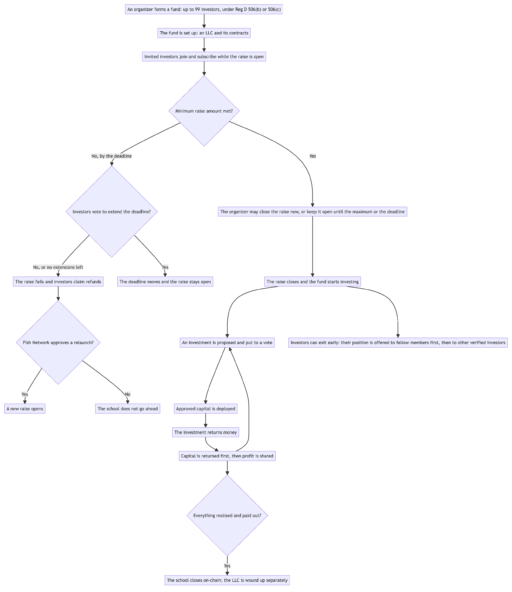
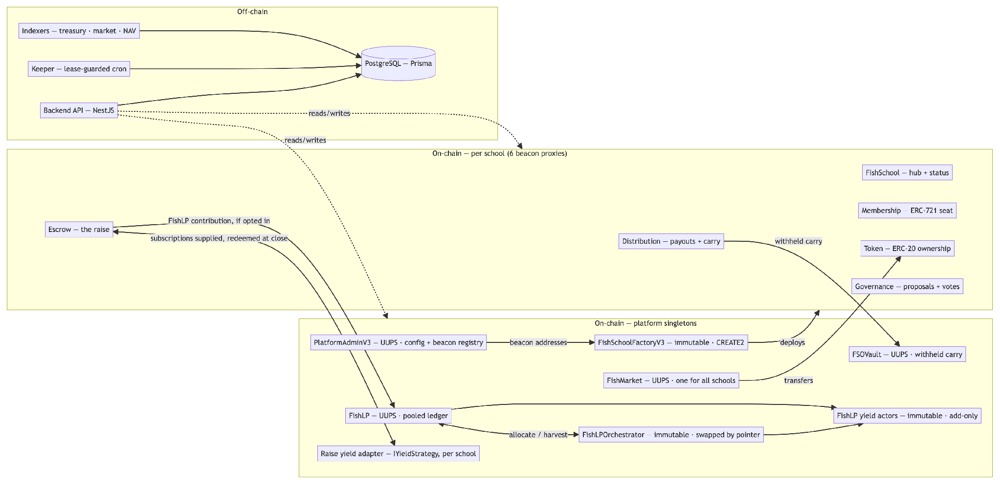
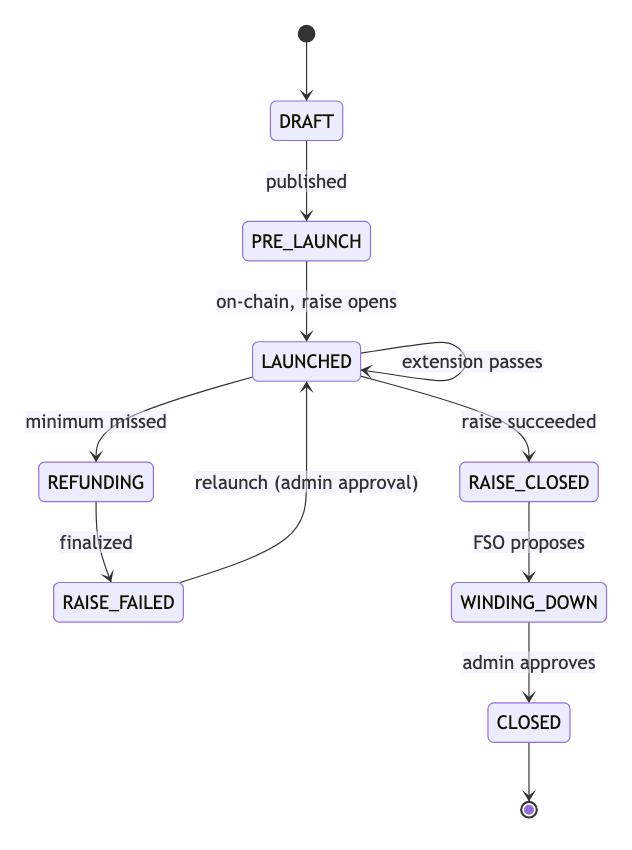
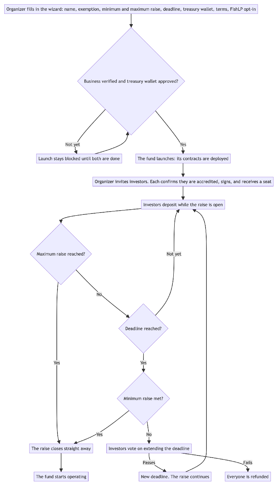
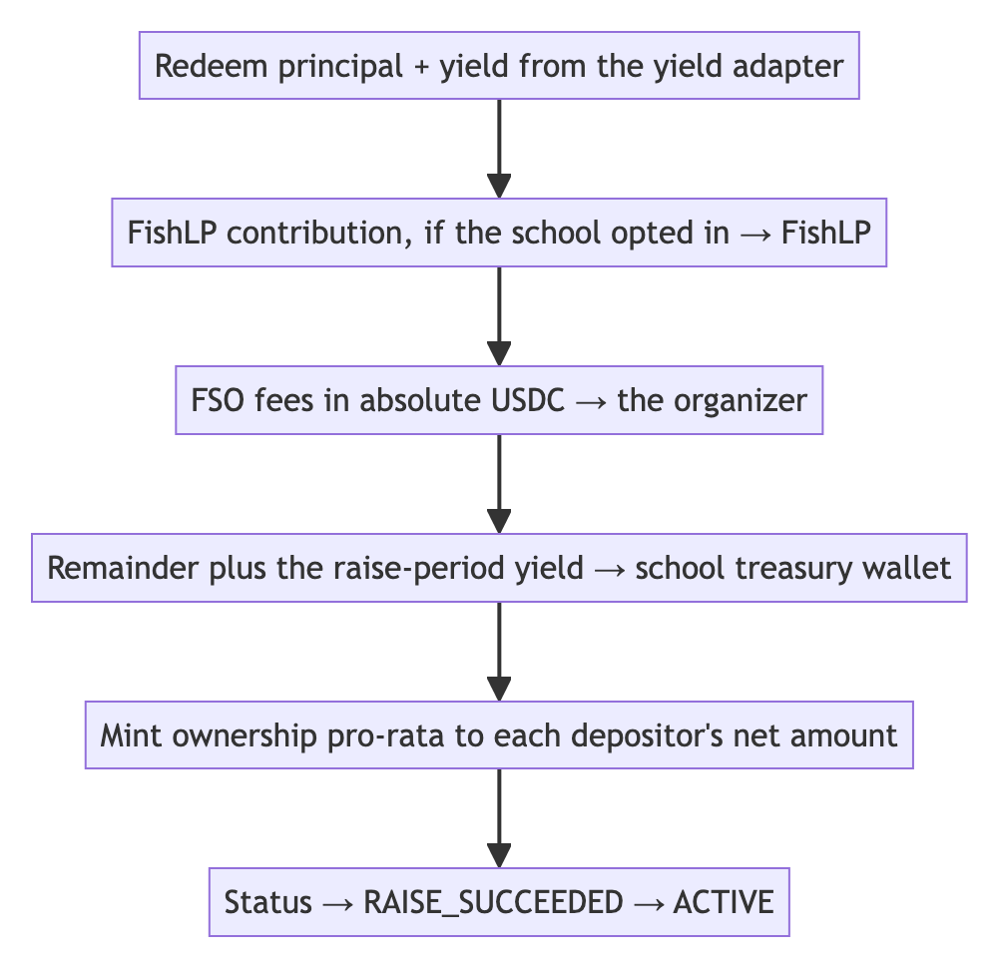
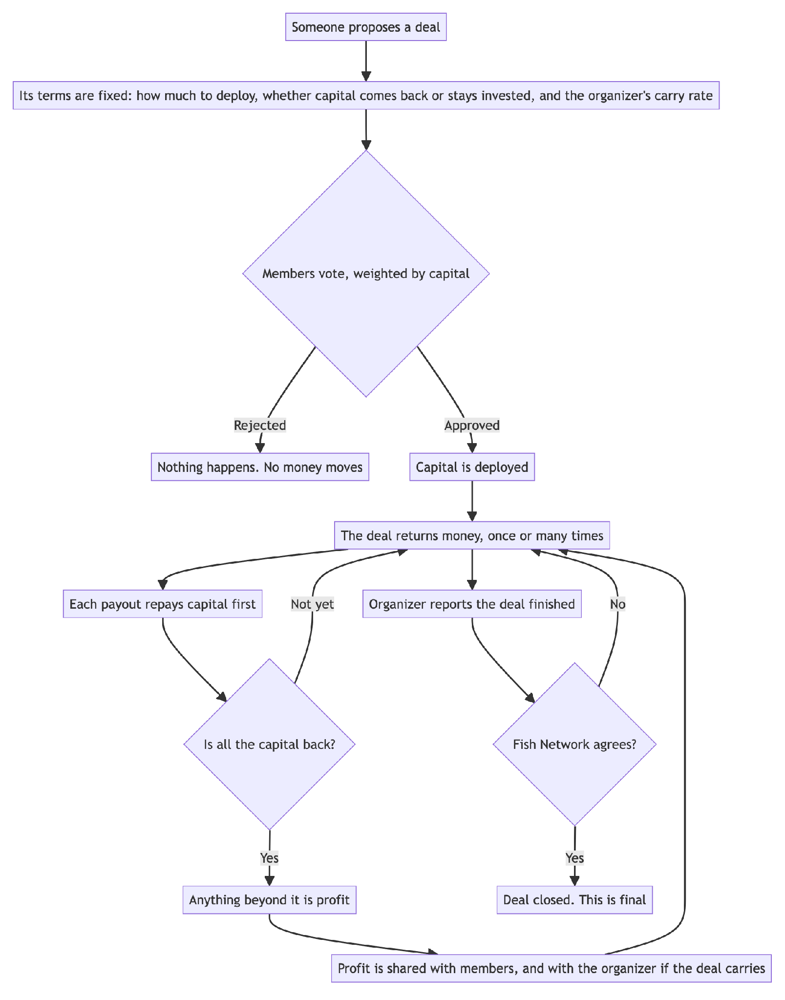
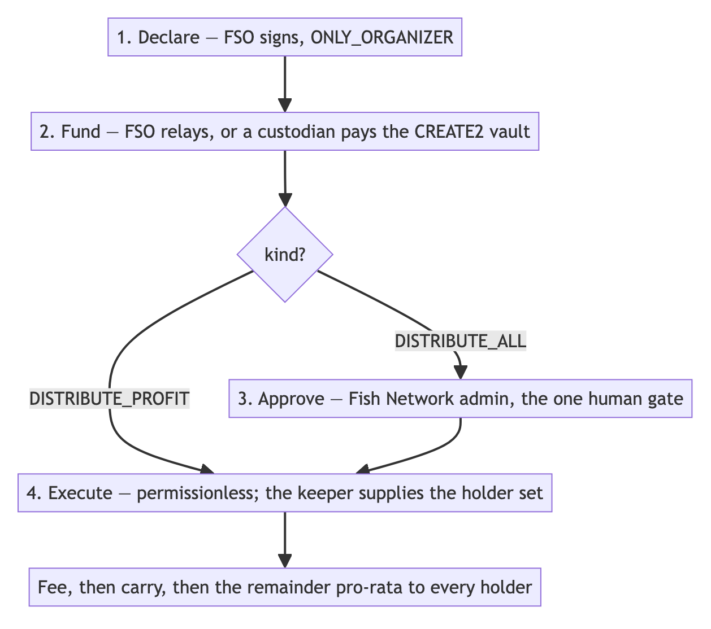
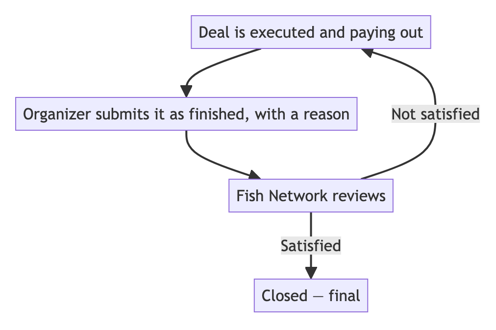
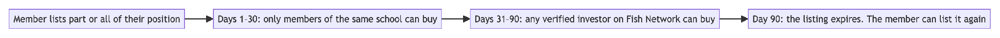
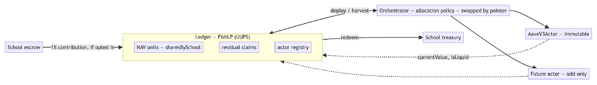

# Fish Network — Technical Whitepaper

*Draft v2 for review — November 2026 · Protocol version V3 · Base Sepolia (chainId 84532) · not yet on mainnet*

> **Review status.** This version folds in the legal review of the 29 August draft (Eric Swartz, Joseph Argiro) and the decisions taken since. Every parameter, formula and behaviour that the code already implements is read from the V3 source at the commit named in §19.

## Contents

- [1. Abstract](#1-abstract)
- [2. Introduction](#2-introduction)
- [3. System overview](#3-system-overview)
- [4. Entity and membership model](#4-entity-and-membership-model)
- [5. Contract architecture](#5-contract-architecture)
- [6. The state model](#6-the-state-model)
- [7. Capital formation](#7-capital-formation)
- [8. Raise failure paths](#8-raise-failure-paths)
- [9. Governance](#9-governance)
- [10. Carried interest](#10-carried-interest)
- [11. Distributions](#11-distributions)
- [12. Secondary market](#12-secondary-market)
- [13. FishLP — the pooled allocation](#13-fishlp--the-pooled-allocation)
- [14. Treasury and banking](#14-treasury-and-banking)
- [15. Fund administration and reporting](#15-fund-administration-and-reporting)
- [16. Off-chain architecture](#16-off-chain-architecture)
- [17. Security model](#17-security-model)
- [18. Testing and verification](#18-testing-and-verification)
- [19. Deployment and parameters](#19-deployment-and-parameters)
- [20. Limitations](#20-limitations)
- [21. Glossary](#21-glossary)
- [Appendix A. Carry across a whole school: four cases](#appendix-a-carry-across-a-whole-school-four-cases)
- [Appendix B. A member’s monthly statement](#appendix-b-a-members-monthly-statement)

## 1. Abstract

Fish Network is a protocol for forming, funding, operating and winding down small private investment funds on-chain. Each fund — a **Fish School** — is a Wyoming or Delaware LLC paired one-to-one with a stack of smart contracts on Base that together perform most of the functions a fund administrator would otherwise perform by hand: capital calls, the cap table, member voting, carried-interest calculation, distribution waterfalls, and transfers of fund interests — offered first to the fund’s own members, then to other verified investors.

The protocol issues no token, runs no consensus mechanism of its own, and has no tokenomics. It is application-layer software that settles on Base.

### The whole system, in one picture

> **In short.** An organizer forms a fund and invites people into it. Those who join decide together what it invests in, and share whatever comes back. Everything below is the detail of making that auditable and difficult to get wrong.



**Four things this design insists on**, each of which costs something:

|                                                                           | Why                                                                                     |
|---------------------------------------------------------------------------|-----------------------------------------------------------------------------------------|
| Each deal returns members’ capital before the organizer earns carry on it | so the organizer never earns a share of members’ own capital coming back to them        |
| Capital-weighted voting                                                   | governance weight follows capital at risk: the members with more invested have more say |
| Terms are frozen when members vote on them                                | a later settings change cannot rewrite an agreed deal                                   |
| Ending a fund takes a deliberate act                                      | no fund closes by timeout, and no closed fund reopens                                   |

## 2. Introduction

### 2.1 The problem

A small private fund — an investment club, a syndicate, a friends-and-family vehicle — carries fund-administration overhead that is significant and nearly independent of fund size. Somebody must maintain the cap table, chase subscription documents, compute each member’s pro-rata share of each distribution, calculate carried interest correctly against a hurdle on a deal-by-deal waterfall with carry held in escrow, and produce a defensible record of who voted for what. At institutional scale this cost is amortised across hundreds of millions of dollars. At \$500,000 it is the reason the fund does not get formed.

Most of that work is deterministic arithmetic over an ownership register. The parts that are not deterministic — deciding what to invest in, valuing an illiquid position, signing a legal document — are precisely the parts that should, and on Fish Network do, stay with people.

### 2.2 What is Fish Network?

Fish Network automates the deterministic part. It does not try to automate the rest; those terms are recorded in conventional legal documents agreed by the parties. A **Fish School Organizer** (FSO) forms a Wyoming or Delaware LLC and a matching on-chain school. Members subscribe in USDC. On a successful raise, ownership tokens are minted pro-rata and the capital lands in a treasury wallet the FSO controls. Deals are proposed, voted on, funded and distributed through the smart contracts.

Legal reality stays off-chain and authoritative. The chain is the register (the membership schedule) and the calculator (the distribution waterfall), not the entity.

**Closing the school on-chain and closing the company are two separate things.** When the fund’s investing life ends, the FSO proposes wind-down, members give an advisory vote, and an administrator closes the school on-chain once every deal is resolved and every dollar owed to members has gone out. The company itself can take longer to finish: there may be final tax filings, accounting fees, an open dispute or a claim to settle. So before the on-chain close, the FSO may set aside a **reserve** for those costs and move it to the company’s own bank account. The school then closes on-chain, the company pays its remaining bills from the reserve, and whatever is left is returned to members directly by the company. Members see the reserve, and what it was for, on their statements (§15).

### 2.3 Design decisions worth stating up front

- **Membership and ownership are different tokens** (§4.3). A seat is a non-transferable ERC-721; ownership is a fungible ERC-20. Selling economic exposure never creates a 100th seat, which is what keeps the fund inside its 100-holder exemption.

- **Voting follows capital** (§9). In v1 every school vote is weighted by each member’s capital, and a member who does not vote is counted as voting yes.

- **Nothing terminal happens on a timer** (§6.2, §8). A passed deadline does not close a raise; it opens a decision. Closing a school and refunding a failed raise both require an affirmative act by a platform administrator.

- **Carried interest is principal-first and snapshotted** (§10). Carry accrues only above a deal’s returned capital. The legal documents set the ceiling, an organizer may choose a lower rate deal by deal, and the rate and split are frozen onto the deal at its first payout.

- **Subscribed capital works during the raise** (§7.3). Deposits are supplied to a yield venue as they arrive rather than sitting idle, and redeemed when the raise resolves. That yield belongs to the members: it becomes the school’s on a successful raise and goes back to each member on a failed one.

- **A fee’s beneficiary is decided by whose money it is** (§7.5, §11.3). Platform fees leave the fund; a FishLP contribution is the school’s own investment and remains the school’s asset.

- **Whether a contract can be changed depends on whether the money in it can be moved** (§5.1, §13.7). If the funds can be withdrawn at any time, the contract never needs changing — a replacement can be deployed and the money moved across. If the funds are locked in something that cannot be sold for years, there is nowhere to move them to, so that contract has to remain changeable.

- **No platform change can rewrite a school’s agreed terms** (§9.4). Organizers vote on changes to the platform’s contracts; a change that would alter an existing school’s agreed economics also needs that school’s own vote.

- **Four state systems exist and only one is authoritative** (§6.1).

## 3. System overview

> **In short.** Each school gets its own set of contracts, cloned from shared templates. A handful of platform-wide contracts sit above them holding settings, the marketplace, withheld carry and the pooled allocation. Off-chain services watch the chain and do the work nobody should have to remember to do.

### 3.1 Architecture



**There are three separate yield relationships.**

Subscriptions do not sit idle during a raise. The escrow supplies every deposit to an Aave-compatible adapter as it arrives, so members’ capital earns for the weeks a raise is open. **The yield always follows the members’ money:**

| Outcome                                                   | Principal                  | Raise-period yield                               |
|-----------------------------------------------------------|----------------------------|--------------------------------------------------|
| **Raise succeeds**                                        | becomes the fund’s capital | goes to the **school’s treasury** with it (§7.5) |
| **Raise fails** — including after a failed extension vote | returned to the member     | returned to the **member**                       |

The refund path does not separate the two: claimRefund redeems the member’s own share of the position **directly to them**, so principal and the yield it earned arrive together. The platform earns nothing on a raise that did not happen — the deposit fee, charged on top at deposit time, is the one cost that does not reverse (§8.2).

The other two relationships are the withheld carry in FSOVault, whose yield goes to the school that carry came from (§10.6), and FishLP’s actors, whose yield accrues to the schools that contributed (§13).

### 3.2 Contract inventory

| Contract                 | Scope      | Proxy pattern                 | Holds funds                                        | Why this pattern                                                                                                                            |
|--------------------------|------------|-------------------------------|----------------------------------------------------|---------------------------------------------------------------------------------------------------------------------------------------------|
| PlatformAdminV3          | platform   | UUPS                          | no                                                 | Config and the beacon registry must evolve; a single upgrade point is the least surprising.                                                 |
| FishSchoolFactoryV3      | platform   | **none — immutable**          | no                                                 | Deploys and initialises; holding no state and no funds, upgradeability would add risk without benefit. Replaced by deploying a new factory. |
| FishMarket               | platform   | UUPS                          | in-flight only                                     | One order book for every school. Was per-school; became a singleton because matching liquidity is the point.                                |
| FSOVault                 | platform   | UUPS                          | **yes** — withheld carry, through a yield strategy | Holds the withheld 80% of carry for every school. Plain balances rather than NAV units, because an organizer is owed a fixed figure.        |
| FishLP                   | platform   | UUPS                          | **no** — ledger only                               | Accounting evolves; funds live in actors so an upgrade never touches custody.                                                               |
| FishLPOrchestrator       | platform   | **none — swapped by pointer** | no                                                 | Allocation policy changes most often. A new deployment plus a pointer cut gives a tested cutover and a real rollback.                       |
| AaveV3Actor              | platform   | **none — immutable**          | **yes**                                            | Thin, and Aave exit is reliable, so migration is always available (§13.7).                                                                  |
| FishSchool               | per school | beacon proxy                  | no                                                 | Six contracts per school must upgrade together; a beacon upgrades all schools in one transaction.                                           |
| FishSchoolMembership     | per school | beacon proxy                  | no                                                 | ERC-721 seats.                                                                                                                              |
| FishSchoolToken          | per school | beacon proxy                  | no                                                 | ERC-20 ownership.                                                                                                                           |
| FishSchoolGovernance     | per school | beacon proxy                  | no                                                 | Proposals and votes.                                                                                                                        |
| FishSchoolEscrow         | per school | beacon proxy                  | **yes** during the raise                           | Holds subscriptions until the raise resolves.                                                                                               |
| FishSchoolDistribution   | per school | beacon proxy                  | **yes** in flight                                  | Payouts and carry; the withheld 80% of each deal’s carry leaves for FSOVault.                                                               |
| DistributionDepositVault | per payout | CREATE2, minimal              | **yes** transiently                                | Address known before deployment, so it can be shown as a QR code (§11.2).                                                                   |

### 3.3 Off-chain components

The backend is not a convenience layer. Three responsibilities cannot live on-chain and are load-bearing:

1.  **Liveness.** Several on-chain actions are permissionless after a deadline, but nobody is incentivised to call them. A keeper does (§16.2).

2.  **History.** A contract’s storage records current state, not how it got there. Listing fills, treasury movements and the FishLP NAV curve exist only if something indexes them as they happen (§16.3).

3.  **Identity and documents.** Identity verification, subscription documentation and email are off-chain for now.

**What is stored where.** The chain holds wallet addresses, balances, votes and payments — and nothing else about a person. Names, email addresses and contact details live in the platform’s database. Identity documents are held by the verification provider (Stripe Identity); the platform keeps only the outcome and a reference to the check. Anything in the database can be deleted on request. A wallet address on-chain cannot be, which is why the chain never holds a name or any other personal detail.

## 4. Entity and membership model

> **In short.** One school is one LLC with at most 99 members. Membership and ownership are deliberately two different things, matching the terms the fund’s legal documents use. A **seat** says you are one of at most 99 members. A **token** says how much of the fund’s profit and loss is yours: your capital contribution divided by everyone’s. You can sell some of your tokens and keep your seat. Once you hold no tokens at all, your seat is removed and your membership ends.

### 4.1 One LLC, one school

A Fish School is a Wyoming or Delaware LLC with an on-chain counterpart. The chain does not transfer legal or beneficial ownership, or title to anything; it maintains the register. Where the two ever disagree, the LLC governs, which is why every terminal transition requires a human act rather than a block timestamp.

### 4.2 The 99-seat cap

Membership is capped at **99 holders**, enforced in two independent places:

- FishSchoolMembership reverts MAX_MEMBERS_REACHED at maxMembers, set to 99 by the factory.

- FishSchoolEscrow reverts at MAX_DEPOSITORS = 99 distinct depositors.

The cap tracks the §3(c)(1) exemption under the Investment Company Act, which is a legal constraint, not a technical one. It is enforced in the contract because a legal constraint that depends on off-chain discipline is one bad afternoon away from being violated. **Seat \#1 is the FSO’s** and counts against the 99.

### 4.3 Seats and ownership are different tokens

This separation is the load-bearing structural decision in the protocol.

|              | Seat                                        | Ownership                                                                                                                                |
|--------------|---------------------------------------------|------------------------------------------------------------------------------------------------------------------------------------------|
| Standard     | ERC-721 (soulbound)                         | ERC-20                                                                                                                                   |
| Transferable | **no**                                      | yes — offered to the school’s own members for 30 days, then to any KYC-verified investor on the platform until the listing expires (§12) |
| Confers      | membership, and the right to vote           | economic exposure, pro-rata, and the weight of that vote                                                                                 |
| Supply       | ≤ 99                                        | totalSupply() = members’ net capital in atomic USDC, fixed after the raise closes                                                        |
| Minted at    | whitelisting, on the FSO’s countersignature | raise close, pro-rata to net deposits                                                                                                    |

**Voting follows capital.** The seat is what entitles a member to vote; the tokens decide how much that vote counts. A member holding 40% of the tokens carries 40% of the weight on every school vote (§9).

#### What a trade does to seats

**Seats are not passed from the seller to the buyer.** They are created and removed instead, and both happen automatically inside the same transaction as the trade:

- **The buyer gets a new seat** — but only if they did not already have one. For the first 30 days a listing is open only to the school’s own members, who already have seats; after that, an investor from outside the school can buy and is given a seat as part of the purchase.

- **The seller loses their seat** — but only if they sold everything. Sell part of your position and you keep your seat, because you are still an investor in the fund.

**The 99 cap is checked at the moment of the fill**, and the order matters: *the seller’s seat is removed before the buyer’s is created*. That single detail decides which trades are possible when a school is full.

| The school is… | The sale is…                     | The buyer is…         | Outcome                                                                                                         |
|----------------|----------------------------------|-----------------------|-----------------------------------------------------------------------------------------------------------------|
| below 99       | any                              | anyone KYC-verified   | works — a seat is created if they need one                                                                      |
| **at 99**      | **the seller’s entire position** | not yet in the school | **works** — the seller’s seat is removed first, then the buyer’s is created. The seat is handed over, not added |
| **at 99**      | **part of a position**           | not yet in the school | **reverts SEATS_FULL** — the seller keeps their seat, so there is none to give                                  |
| **at 99**      | part of a position               | already in the school | works — no new seat is needed                                                                                   |

So a member of a full school who wants to sell has two options: sell **all** of their position to someone not yet in the school, or sell **part** of it to someone already inside. Nothing else fits without exceeding 99 investors.

**The organizer is the exception.** Their seat is locked and cannot be removed, so an organizer who sells their entire position still keeps their seat — and their listing is blocked separately anyway (FSO_SEAT_LOCKED), so the primary organizer cannot sell out from under the fund they manage.

> **Example — economics and votes move together.** A school of 10 members raised \$1,000,000. Alice put in \$400,000; Ben put in \$10,000.
>
> Alice receives 40% of every payout and Ben 1%. On a vote to wind the school up, Alice’s ballot carries 40% of the weight and Ben’s 1%.
>
> Alice sells half her position to Ben. Her payouts and her voting weight fall to 20%; his rise to 21%. The school still has 10 members: no seat was created or removed, because Ben already had one and Alice still holds tokens.
>
> **Example — a full school.** The same school is now at 99 members. Carol wants to sell.
>
> She can sell her **whole** position to someone not yet in the school: her seat is removed, theirs is created, and the school is still at 99.
>
> She cannot sell **half** to that person — she keeps her seat, so the buyer’s would be the hundredth, and the trade reverts SEATS_FULL. To sell half, she has to sell it to someone already in the school.

## 5. Contract architecture

### 5.1 Three proxy patterns, chosen for three different reasons

The codebase deliberately does not standardise on one pattern.

- **Beacon proxies for per-school contracts.** A school’s six contracts are versioned as a set. A bug in the escrow must be fixable for every school at once; upgrading a thousand proxies individually is not an operation anybody performs correctly under pressure. One beacon write covers every school.

- **UUPS for platform singletons.** There is one of each, so per-instance upgrade cost is irrelevant and UUPS keeps the upgrade authority inside the contract being upgraded.

- **Immutability where migration is available.** The factory, the orchestrator and the yield actors have no proxy. §13.7 develops the test that decides this: immutability is affordable exactly when you can always get the funds out, because then a bug is fixable by migration.

### 5.2 Deterministic addresses

Per-school proxies are deployed with CREATE2 under

``` solidity
salt = keccak256(abi.encode("FishSchoolV3", schoolId, kind))
```

so a school’s contract addresses are computable before deployment. The same technique gives each payout a deposit vault whose address can be shown to a custodian before it exists (§11.2).

### 5.3 Namespaced storage

Upgradeable contracts use **ERC-7201** namespaced storage. Each contract’s state lives in a struct at a computed slot rather than in sequential slots, so adding a field to a base contract cannot shift a derived contract’s storage.

> **Operational rule:** appended fields go at the **end** of the struct. This is the single most dangerous edit in the codebase — reordering fields in an upgrade silently reinterprets existing storage. Several storage layouts here carry comments marking fields as appended, and those comments are load-bearing.

### 5.4 Upgrade authority

Every upgrade path — UUPS \_authorizeUpgrade, beacon upgradeTo, orchestrator pointer, actor registration — is onlyOwner, and the owner is the platform key. **Who decides an upgrade is separate from who signs it.** Changes to the platform’s contracts are decided by a vote of the organizers (§9.4) and then signed by the owner key after a seven-day notice period, so anyone who disagrees can act before it takes effect. That notice period becomes an on-chain timelock before mainnet (§20).

## 6. The state model

> **In short.** A school moves through a fixed sequence — raising, active, winding down, closed — and the chain refuses to skip steps. Deals have their own smaller sequence inside that.

### 6.1 Four state systems

| System                        | Where    | Role                                                                             |
|-------------------------------|----------|----------------------------------------------------------------------------------|
| FishSchoolLifecycleStage      | database | **authoritative** — what the product means by “what stage is this fund at”       |
| IFishSchool.Status            | on-chain | what the contracts enforce                                                       |
| IFishSchoolEscrow.EscrowState | on-chain | the raise sub-machine                                                            |
| FishSchoolStatus              | database | **legacy** — kept in step for about 200 references across 63 files; no new logic |

### 6.2 The authoritative lifecycle



| Stage        | Means                                                                                                |
|--------------|------------------------------------------------------------------------------------------------------|
| DRAFT        | wizard in progress                                                                                   |
| PRE_LAUNCH   | published, not yet on-chain                                                                          |
| LAUNCHED     | on-chain, raise open, accepting deposits                                                             |
| RAISE_CLOSED | raise over — **the fund is operating and doing deals**                                               |
| WINDING_DOWN | no new deals; selling assets and paying the proceeds out to members                                  |
| CLOSED       | every deal resolved, everything owed to members paid out, any reserve moved to the company’s account |

CLOSED is about the school on-chain, not the company. The company may still be paying its last costs from the reserve described in §2.2; that happens off-chain and does not reopen the school.

**A school must also have no unsettled FishLP claim before it may close** (§13.6), so that the LLC still exists to receive what a long-dated holding eventually pays.

### 6.3 On-chain status

IFishSchool.Status values actually written: RAISE_OPEN, RAISE_SUCCEEDED (transient — overwritten by ACTIVE inside the same transaction), ACTIVE, RAISE_FAILED, WINDING_DOWN, CLOSED. DISSOLVED is retired and never set; it keeps its enum slot so later values keep their numbers.

Transitions are guarded on-chain:

``` solidity
require(prev != Status.CLOSED, "CLOSED_IS_TERMINAL");
if (next == Status.WINDING_DOWN) require(prev == Status.ACTIVE, "WIND_DOWN_NEEDS_ACTIVE");
if (next == Status.CLOSED)       require(prev == Status.WINDING_DOWN, "CLOSE_NEEDS_WINDING_DOWN");
```

## 7. Capital formation

### 7.1 Creating a school

> **In short.** The organizer sets the terms and the deadline, the platform checks the business is real and the bank account approved, and only then can the fund launch. After that it is investors depositing against a clock.



The FSO completes a wizard — basic info → entity → treasury wallet → terms → review — and launch deploys the six-contract stack. **Two things gate the launch button**: the organizer’s business must be KYB-verified, and the treasury wallet must be on the platform whitelist. Neither can be satisfied after the fact, because both decide where members’ money is allowed to go.

In the wizard the organizer also makes three choices that are fixed for the life of the school:

- **The exemption: Reg D 506(b) or 506(c).** A tooltip explains the difference and links to a full explanation. In short, a 506(b) school may not advertise and is offered only to people the organizer already knows; a 506(c) school may be promoted publicly but may only accept accredited investors.

- **The voting rule.** In v1 every school votes by capital (§9), so this is not offered as a choice yet. The contracts already support one member, one vote, for a later version.

- **Whether to contribute to FishLP** (§13). If the organizer ticks the box, 1% of the raise goes to FishLP when the raise closes; if not, nothing does.

**The minimum and maximum raise.** The minimum aggregate capital commitment (the soft cap) is at least \$10,000. The maximum (the hard cap) is at least the minimum and at most **\$12,000,000**, the ceiling that applies under the exemption the school relies on. Setting the two equal produces a warning: the raise then closes the instant it reaches its minimum and the deadline never applies.

**Treasury wallet.** Captured in the wizard and required to be on the platform whitelist before launch. The same value flows database → launch parameter → on-chain fishSchoolTreasuryWalletAddress(), and it cannot be changed once the school is deployed.

### 7.2 Joining a school

Before anyone can join a school they confirm, once, that they are an accredited investor. The screen explains what that means and links to the SEC’s definition. A member can change this in their profile at any time. Someone who says they are not accredited cannot join new schools, but stays a member of any school they have already joined.

The FSO then invites members; each accepts and signs the offering documentation. On the FSO’s countersignature the member is whitelisted and receives a seat. Seat \#1 belongs to the FSO and is locked (§12).

### 7.3 Deposits and the deposit fee

> **In short.** The deposit fee is charged **on top** of what a member invests, and a larger investment pays a lower rate. It is taken at the moment of deposit and is not returned if the raise later fails — but it is counted when deciding whether members have been paid back in full (§10.3).

A member deposits investmentAmount; the platform deposit fee is charged **on top**, so the full amount subscribed is the amount invested and the amount that mints ownership.

fee = investmentAmount × depositFeeBps(investmentAmount) / 10 000  
total charged = investmentAmount + fee

| Investment         | Fee   |
|--------------------|-------|
| below \$10,000     | 1.00% |
| \$10,000 and above | 0.50% |

Both rates and the \$10,000 threshold are set from the admin panel and can be changed for schools launched later.

**v1 has a single step at \$10,000.** Because the rate drops at that point, a member investing \$9,999 pays a \$99.99 fee while one investing \$10,000 pays \$50. The contract already supports the alternative: a sliding scale that moves the rate gradually between thresholds, so investing one more dollar never lowers the total charged. The platform can switch to it from the admin panel later without a contract change.

> **Example.** A member investing \$5,000 pays \$5,050. A member investing \$50,000 pays \$50,250. Each is credited with exactly what they invested: 5,000 and 50,000 ownership units.

**Invested capital is not idle while the raise is open.** Every deposit is supplied to the escrow’s Aave-compatible yield adapter as it arrives, and principal plus accrued yield is redeemed when the raise resolves — whether it closes successfully, refunds, or is swept. A raise that runs for weeks therefore earns for those weeks instead of parking members’ money in a contract.

**That yield always follows the members’ money:**

|                                                                                                  | Principal                  | Yield earned during the raise                    |
|--------------------------------------------------------------------------------------------------|----------------------------|--------------------------------------------------|
| **The raise succeeds**                                                                           | becomes the fund’s capital | goes to the **school’s treasury** with it (§7.5) |
| **The raise fails** — under its minimum at the deadline, and again after a failed extension vote | returned to the member     | returned to the **member** as well               |

On a refund the two are not separated: claimRefund redeems the member’s own share of the position directly to them, so the principal and the yield it earned arrive in the same transfer (§8.2). The platform keeps nothing from a raise that did not happen — with one exception, stated because members will otherwise assume otherwise: **the deposit fee is not refunded.** It was charged on top at deposit time and paid out immediately, so it never sat in the escrow to be returned.

On testnet the adapter is StubAavePool at 1:1, so there is no yield to accrue either way (§20.1).

### 7.4 Closing the raise

| Path            | Trigger                            | Actor                                |
|-----------------|------------------------------------|--------------------------------------|
| Maximum reached | totalRaised == hardCap             | backend keeper calls closeRaise()    |
| Early close     | minimum met, FSO decides           | FSO, or an administrator as backstop |
| Extension       | deadline passed, below the minimum | member vote (§8.1)                   |
| Undersubscribed | deadline + 72h, below the minimum  | refunds (§8.2)                       |

**The organizer does not have to wait for the deadline.** As soon as the minimum has been raised, the organizer can close the raise and start the school — there is no need to wait for the deadline or the maximum. An administrator can do the same as a backstop.

> **Example.** A school’s minimum is \$250,000, its maximum \$500,000, and its deadline 60 days away. By day 20 investors have committed \$310,000 and the organizer has a deal ready. They close the raise that day: ownership is minted for the \$310,000 and the school starts operating.
>
> **Nothing closes on its own when a deadline passes.** That is deliberate. A deadline reaching zero opens a decision — extend, close early, or refund — and the keeper closes only when the maximum is reached, where the outcome is arithmetically certain.

### 7.5 The close waterfall



Two properties of this waterfall are worth stating precisely, because both are easy to misread:

**The FishLP rate is fixed at launch, not read at close.** The school’s rate — 1% if it opted in, 0% if not — is copied into the escrow when the school is created. Reading the platform value at close would apply a later change to a school whose members subscribed on a different number.

**Both FSO fee lines pay the organizer.** adminFeeUsdc and organizerFeeUsdc are both transferred to school.organizer(). The name “admin fee” refers to *fund administration*, which the FSO performs — it is not a platform fee. The platform caps their sum at 20% of the minimum raise at initialisation. This naming has misled readers of this code before and is flagged in §20.

A defensive clamp scales both fees proportionally if the principal pool cannot cover the FishLP contribution plus fees. It is unreachable from closeRaise() given the initialisation check, and is retained for the soft-cap close paths.

### 7.6 Where protocol revenue accrues

| Source                          | Rate                                                                                       | Destination  |
|---------------------------------|--------------------------------------------------------------------------------------------|--------------|
| Deposit fee                     | 1.00% below \$10,000; 0.50% from \$10,000                                                  | feeRecipient |
| Distribution fee                | 0% by default, on the capital leg of a payout                                              | feeRecipient |
| Fee on members’ share of profit | 0% by default                                                                              | feeRecipient |
| Fee on the organizer’s carry    | 3% of the carry, taken from the part paid at the time                                      | feeRecipient |
| Fee on withheld carry claimed   | 3% of what the organizer withdraws from FSOVault; none on carry forfeited to members       | feeRecipient |
| Distribution rounding           | under one millionth of a USDC per holder per payout — less than \$0.0001 across 99 holders | feeRecipient |
| Marketplace fees                | 3.00% from the buyer + 3.00% from the seller                                               | feeRecipient |

**What is not platform revenue:**

| Source                                                                          | Goes to                                      |
|---------------------------------------------------------------------------------|----------------------------------------------|
| Raise-period yield                                                              | the school’s treasury                        |
| Yield on withheld carry                                                         | the school the carry came from (§10.6)       |
| FSO admin + organizer fees — absolute USDC, ≤ 20% of the minimum raise combined | the organizer                                |
| FishLP contribution — 1% of the raise if opted in                               | FishLP, as the school’s own investment (§13) |

## 8. Raise failure paths

> **In short.** A raise that misses its target can be extended by a member vote. If that fails too, everyone gets their money back — their deposit plus its share of the yield it earned while waiting, but not the deposit fee.

**Three different things can happen to a raise that falls short, and they are easy to confuse:**

|                         | When                                                           | What it means                                                                           | Who decides                                                                               |
|-------------------------|----------------------------------------------------------------|-----------------------------------------------------------------------------------------|-------------------------------------------------------------------------------------------|
| **Extension** (§8.1)    | the deadline passes and the minimum has not been reached       | the *same* raise stays open longer, with the same investors and their money still in it | the organizer asks, an administrator approves, and the investors vote                     |
| **Refund** (§8.2, §8.3) | the minimum is still not reached — no extension, or it ran out | the raise is over; every investor takes their money back                                | an administrator approves; each investor claims their own refund                          |
| **Relaunch** (§8.4)     | after a raise has failed and everyone has been refunded        | a *brand new* raise for the same school, starting from zero                             | an administrator approves; there is no investor vote, because nobody is invested any more |

> **Example.** An organizer aims to raise a minimum of \$500,000 in 60 days. On day 60 the school has \$420,000.
>
> **Extension:** the organizer asks for 30 more days, Fish Network agrees, and the investors vote. The vote passes, the \$420,000 stays where it is, and the raise continues to day 90. New investors can still join.
>
> **Refund:** on day 90 the school has \$470,000, still short, and there are no extensions left. The raise fails. Each investor claims back what they put in plus the yield it earned, less the deposit fee.
>
> **Relaunch:** two months later the organizer has lined up new commitments and asks to try again. Fish Network approves. The school opens a fresh raise with a new deadline and an empty balance; anyone who wants in, including the earlier investors, deposits again.

### 8.1 Extensions

Deadline passed and below the minimum: the FSO requests an extension within a 48-hour window, an administrator approves, and an extension vote opens for 7 days. **It is counted the same way as every other school vote** (§9.1): weighted by what each member has deposited, with silence counted as a yes, and it needs at least one real ballot.

At most **2** extensions, each at most **30** days. One approval grants exactly one extension — extensionDealUnlocked is consumed when the extension proposal is created, so an approval cannot be reused.

### 8.2 Refunds

If the raise fails, the FSO requests refunds and **an administrator approves**, which submits finalizeIfUndersubscribed() on-chain. Members then claim individually.

Administrative approval is required because members’ money is moving. This is the same principle as §6.2: the protocol does not perform a terminal act on a timer.

### 8.3 Refunds nobody claims

> **In short.** Refunds are claimed by the member, not pushed to them — so some never get claimed. After 90 days the remainder is moved to a holding account so the school can finish, and it is still owed to whoever left it behind.

**The problem it solves.** A refund has to be pulled by the member. Some never will: keys are lost, email goes unread, people move on. Without a way to finish, a school with \$200 unclaimed stays in REFUNDING **forever** — and because a school cannot relaunch until it reaches a terminal state, one member who stopped paying attention blocks everyone else from ever trying again.

| **When**              | 90 days after the school entered REFUNDING (UNCLAIMED_WINDOW)                                                                               |
|-----------------------|---------------------------------------------------------------------------------------------------------------------------------------------|
| **Who triggers it**   | an administrator, via forceFinalizeRefunds — never automatic                                                                                |
| **Where it goes**     | unclaimedFundsRecipient, a segregated holding account for money still owed                                                                  |
| **What is recorded**  | every unclaimed depositor and the exact amount they were owed, on-chain                                                                     |
| **What happens next** | it is paid to the member when they come forward, or, once the unclaimed-property period has passed, handed to the state as the law requires |

**This is not the platform taking the money.** It is member money that moved to an address where it can still be returned, and the per-depositor record is what makes returning it possible years later. The events reconcile against the aggregate because each amount is that depositor’s share of what was actually redeemed, not of what they originally deposited.

**The address has no default, deliberately.** It starts at zero and the sweep reverts RECIPIENT_UNSET rather than guessing a destination for member funds. That strictness has a cost worth knowing: leaving it unset arms a fault that only appears weeks later — the school cannot finish, so it can never relaunch, and nothing on screen says why. The deploy script therefore sets it, and Platform Controls shows a blocking warning while it is unset.

**Nothing to sweep, nothing to wait for.** A raise that attracted no deposits finishes immediately rather than sitting out 90 days protecting nobody.

> **Example.** A raise fails with \$50,000 owed across 12 members. Eleven claim within a fortnight. One — owed \$200 — never responds.
>
> After 90 days an administrator sweeps the \$200 to the holding account. The chain records that this member is owed \$200. The school reaches RAISE_FAILED and can attempt a fresh raise. If the member reappears in 2029, what they are owed is still on record.

### 8.4 Relaunch

> **In short.** A school whose raise failed can start a new raise, but only once Fish Network approves it. It is not a continuation of the old raise — that money has already been refunded — and approval is a decision someone makes, not a timer that runs out.

The gate is a single flag per school. restartRaise refuses unless an administrator has switched it on, and the same administrator can switch it off again.

| **Who can restart**               | the organizer or an administrator, once approval is in place                     |
|-----------------------------------|----------------------------------------------------------------------------------|
| **What the chain checks**         | the raise actually failed, approval is on, and the new deadline is in the future |
| **What the chain does not check** | how long ago the failure was, or how many times this school has already tried    |

**The cooldown and the attempt limit are policy, not code.** relaunchCooldownDays (14) and maxRelaunchAttempts (1) exist as platform parameters and are shown in Platform Controls, but no contract or service enforces them — approval is the only gate that actually holds.

It cuts both ways. An administrator can approve a relaunch **sooner than 14 days** when an organizer asks and the reason is good — a raise that failed on a fixable technicality should not have to wait a fortnight. Equally, an administrator can decline one that is technically eligible.

**Approval does not expire when it is used.** The flag stays set after a restart, so a school approved once can restart again until someone withdraws it with disableRelaunch. That withdrawal is what makes an approval a decision rather than a permanent unlock.

## 9. Governance

> **In short.** Members vote on deals, on extensions, and on winding the school up. Each vote counts in proportion to the member’s capital. A member who does not vote is counted as voting yes, so a proposal fails only if the members who actively vote no hold more capital than everyone else combined. Voting is open until the deadline, and a member may change their mind until it closes.

**The life of a deal**, from proposal to closed:



Everything the members are agreeing to is settled **before** the vote — the amount, whether their capital returns, and what the organizer earns. Nothing in those terms can be changed afterwards, which is why the ballot is the only place they appear.

### 9.1 How a school vote is counted

**Weighted by capital.** Each ballot carries the member’s capital at the moment the proposal opened: their ownership tokens once the raise has closed, or what they had deposited if the proposal opens during the raise. That figure is fixed on the ballot the first time the member votes, so changing a vote moves exactly what was counted and a later trade cannot change a ballot already cast.

**Silence counts as yes.** A member who does not vote is treated as voting in favour. This is the consent model operating agreements use, rather than the quorum model of shareholder meetings: in a school of two, a proposal the other member simply ignored would otherwise die for want of a quorum, which is not what either of them meant by joining a fund together.

passes ⇔ at least one real ballot was cast  
and capital for + capital that stayed silent ≥ capital against

**Ties pass.** A fund that cannot act while evenly split is a fund that cannot act. Taken together with silence counting as yes, this has a consequence members must be told plainly: in a school of two where one member votes no and the other stays silent, the proposal **passes**. Not voting is not neutral here; it is a vote in favour.

**At least one real ballot.** Without that floor, a proposal nobody opened would pass on its own deadline. A school can raise the floor (minParticipationBps); by default one ballot is enough.

**The organizer votes on everything**, including a deal that pays them carry, and counts in its electorate. Members are told every vote is open and that no answer counts as approval, and they can vote no; a stricter rule, if a school wants one, belongs in its operating agreement.

**Voting is open for 7 days by default**, and a member may change their vote at any time before it closes. All five ways of creating a proposal run through one internal \_createProposal, which is where the lifecycle check lives — one check rather than five copies of it.

### 9.2 Finalisation

After the deadline the proposal can be finalised **by anyone**, because at that point the outcome is arithmetic. The FSO normally does it; a keeper acts as a backstop so an abandoned proposal cannot freeze a school (§16.2).

**Ending a vote early.** Once every member in the electorate has voted, nothing left can change the result, so the organizer may close the vote before its deadline and the outcome takes effect straight away. The rule is “everyone has voted”, not “enough have voted”: while any member has yet to vote, their silence still counts and the vote stays open until the deadline.

> **Example.** A deal goes to a 7-day vote in a school of five. By day 2 all five members have voted — four yes, one no. The organizer closes the vote that afternoon and the deal is approved without waiting five more days.

The electorate and each member’s capital are taken from the snapshot at the proposal’s opening, not the current membership, so a member joining or leaving mid-vote cannot move the result.

### 9.3 Distribution policy

Every deal carries a policy, voted on with the deal:

| Policy            | Capital                     | Profit                                   | Carry eligible |
|-------------------|-----------------------------|------------------------------------------|----------------|
| DISTRIBUTE_ALL    | returns to members          | returns to members, subject to any carry | yes            |
| DISTRIBUTE_PROFIT | not scheduled to return yet | returns to members, subject to any carry | yes            |

Carry applies to both policies, because profit means the same thing under each: what remains once the deal has returned the capital it was given (§11.3). Whether that capital is scheduled to reach members or stay invested decides where it goes, not whether a profit exists. The protection is arithmetic rather than a rule — a deal below its capital produces no profit and therefore no carry, with nothing to check separately.

**A second choice rides on DISTRIBUTE_PROFIT: reinvest or distribute.** When the capital is eventually realised, it either returns to members pro-rata or goes to the school’s treasury to fund the next deal. Subject to the school’s documents, the organizer may propose to recycle capital deal by deal; the choice is fixed in the ballot rather than made at exit, because it is members’ capital under either answer.

Reinvested capital deliberately does **not** count towards paying members back (§10.3). Money routed to the treasury has not reached members, so it must not advance the line that releases the organizer’s withheld carry.

A member other than the organizer proposing DISTRIBUTE_PROFIT needs the organizer to co-sign **before** the ballot opens, since it commits the fund to keeping capital deployed.

### 9.4 Votes by organizers on platform changes

> **In short.** The platform’s own contracts are changed only after the organizers vote on it. Each organizer’s vote counts in proportion to the capital they manage, and an organizer who does not vote is counted as agreeing. No platform vote can change the terms a school has already agreed; that still takes the school’s own members.

Fish Network proposes; the organizers decide. An administrator posts a vote in the admin dashboard with a title, a description, its impact — which contracts and which schools it touches, and whether it changes anyone’s economics — and a deadline. Every organizer sees it and votes.

| **Who votes**       | every organizer of a school that has not closed                                                                                         |
|---------------------|-----------------------------------------------------------------------------------------------------------------------------------------|
| **Weight**          | the paid-in capital of the schools they run, taken when the vote opens                                                                  |
| **Silence**         | counted as yes, with at least one real ballot required — the same rule as school votes                                                  |
| **Ballots**         | signed with the organizer’s wallet and kept, so the result can be checked independently                                                 |
| **Ending early**    | an administrator may close the vote before its deadline once every eligible organizer has voted                                         |
| **After it passes** | a seven-day notice period, then the change is made. Anyone who disagrees has that week to act — for example, to sell on the marketplace |

**What a platform vote cannot do.** Each school’s fees, carry, waterfall and voting rule are fixed when its members agree them, and no platform change may rewrite them. A change that would alter an existing school’s agreed terms needs that school’s own members to approve it as well, by the capital-weighted vote in §9.1. That is the one point at which members vote on platform changes, and it is the point at which it matters to them.

**Emergencies are the exception.** A security fix or a pause cannot wait a week. It is applied immediately, disclosed to every organizer within 48 hours, and put to a vote to ratify it; if the vote fails, the change is reversed wherever that is possible.

The same mechanism decides how FishLP is used (§13.8), with two differences: only organizers of schools that contribute to FishLP vote, and each vote is weighted by their schools’ share of FishLP rather than by total capital.

## 10. Carried interest

> **In short.** The organizer takes a share of profit — never of capital — and only after a deal has returned everything it was given. A fifth of it is paid at the time. The rest is withheld in a vault until members have been paid back everything they paid in, including the deposit fee, and is the first money used to make them whole if the school ends short. All carry the organizer receives remains subject to a contractual clawback.

### 10.1 A rate the FSO chooses, under a ceiling set by the legal documents

The FSO picks the rate per deal, from 0.01% up to PlatformAdmin.carryBps (default **20%**). Leaving it blank means zero rather than the ceiling: a deal carries only at a rate somebody chose.

This supports the range of vehicles the protocol serves. An investment club may take 1% or none; a syndicate with a professional lead may take the conventional 20%.

Two independent ceilings apply:

| Bound                  | Value          | Nature                                                                    |
|------------------------|----------------|---------------------------------------------------------------------------|
| PlatformAdmin.carryBps | 2000 bps (20%) | platform policy, set by an administrator in line with the legal documents |
| MAX_CARRY_BPS          | 5000 bps (50%) | **hard-coded in the contract** — an administrator cannot exceed it        |

The hard ceiling exists so that a compromised or mistaken administrative key cannot authorise an arbitrary carry rate. How profit is shared between the organizer and the members once capital is returned, and how the carry is split between paid and withheld, are set by Fish Network administrators according to the legal documents; an organizer cannot change either.

### 10.2 Principal first

Carry accrues only on profit above the capital the deal was given, measured **cumulatively across every payout** through a per-deal DealLedger:

outstanding = max(principal − returned, 0)  
profit = max(payout − outstanding, 0)  
carry = profit × carryBps / 10 000

Measuring the return of members’ capital cumulatively, rather than payout by payout, is what stops a deal returning capital in instalments from paying carry on each instalment as though it were profit.

### 10.3 A fifth now, the rest withheld and underwriting the fund

Carry splits by carrySplitBps (default **2000**, a fifth):

- **Paid immediately:** carry × carrySplitBps / 10 000, less the platform’s 3% fee charged on the *whole* carry (§11.3)

- **Withheld:** the remainder, transferred to FSOVault (§10.6)

The withheld portion is not an escrow waiting on a date. It is the buffer that covers members if the school does not return what they paid in, which is why it is four fifths rather than half.

**The gate is what members have actually received:**

gate = cumulativeDistributed \>= totalSupply + deposit fees members paid

totalSupply() is members’ net capital, and the deposit fees are what they paid on top of it, so the right-hand side is every dollar members put in. Carry is not released while members are still down on the cash they paid.

**Money in the school treasury counts for nothing**, and that is the load-bearing choice. Undistributed capital is capital the organizer still controls and can still lose, so treating it as returned would release the buffer while the money is still at risk — and if the next deal then went badly, the money meant to cover members would already have been paid out. Only what has left for members moves the counter.

Because cumulativeDistributed only ever increases, the gate is a pure ratchet: there is no window in which it opens against money still at risk.

It is deliberately slow for a school that reinvests — capital routed back to the treasury does not count, so such a school waits. It always resolves: at wind-down, everything owed to members is paid out and the counter moves then.

**The release is fund-level, not deal-level, and that is the safety.** Carry is earned deal by deal, so it is charged on the winners while the losers are still open; without a fund-level release, a manager could keep carry on a fund that lost money overall.

**One gate, and it opens for the whole balance:**

| School state | Members paid back in full? | Withdrawable                                     |
|--------------|----------------------------|--------------------------------------------------|
| operating    | no                         | nothing                                          |
| operating    | yes                        | all of it, less the 3% claim fee                 |
| WINDING_DOWN | yes                        | all of it, less the 3% claim fee                 |
| WINDING_DOWN | no                         | nothing — the balance settles to members instead |

The school’s own state is not part of the test. There is no schedule and no partial release: the gate is shut for the whole time any part of what members paid in has not reached them, and the moment it all has, the organizer may take everything withheld. An organizer who has already returned every dollar members put in is not made to wait years for the compensation those returns earned.

The ceiling is measured against **lifetime accrual**, not the live balance, so carry withheld after a withdrawal is claimable in its own right rather than being shadowed by what was already taken.

> This is a return-of-capital test, not a whole-return test: it does not account for the time value of money, and there is no preferred return.

**If the school ends short**, the shortfall is settled once, at wind-down, against the whole book:

shortfall = max(totalSupply + deposit fees − cumulativeDistributed, 0)  
to members = min(shortfall, withheld balance), with no fee  
to the FSO = the remainder, less the 3% claim fee

Netting at the end rather than deal by deal is what stops an organizer being debited for one bad deal that their other deals more than cover. It also means a school \$5,000 short costs its organizer \$5,000 rather than their entire balance.

**The contracts cannot reach carry already paid out.** The fifth paid at the time, and anything the organizer has already withdrawn, has left the contracts. Under the school’s operating agreement, all carry an organizer receives is subject to a customary clawback if it later turns out members were not made whole; fees are not. That obligation is contractual and is enforced as a contract, outside the smart contracts. Fish Network’s records show each organizer’s carry received, so the amount is known if it is ever called on.

### 10.4 Snapshotting

> **Example.** A deal is approved at 20% carry. Six months later the platform lowers its ceiling to 10%. That deal still pays 20%, because members voted on 20% — and a deal approved after the change pays at most 10%. Terms follow the ballot they were agreed on, not the configuration on the day money moves.

Rate, split and principal are frozen onto the deal at its **first payout** and enforced immutable on subsequent payouts (BASIS_LOCKED, CARRY_LOCKED).

Reading either value live would let a platform-level change rewrite terms members already voted on. The basis is locked in the same place and for a sharper reason: shrinking a deal’s principal after the fact would reach the carry threshold sooner and pay carry on capital.

### 10.5 Worked example

A \$100,000 deal, 20% carry, a fifth paid at the time, and the platform’s 3% fee on the organizer’s carry, returning in three payouts.

| Payout    | Amount        | Outstanding before | Profit       | Carry        | FSO now     | Withheld    | To members    |
|-----------|---------------|--------------------|--------------|--------------|-------------|-------------|---------------|
| 1         | \$60,000      | \$100,000          | \$0          | \$0          | \$0         | \$0         | \$60,000      |
| 2         | \$60,000      | \$40,000           | \$20,000     | \$4,000      | \$680       | \$3,200     | \$56,000      |
| 3         | \$30,000      | \$0                | \$30,000     | \$6,000      | \$1,020     | \$4,800     | \$24,000      |
| **Total** | **\$150,000** |                    | **\$50,000** | **\$10,000** | **\$1,700** | **\$8,000** | **\$140,000** |

Carry totals 20% of the \$50,000 profit and not a cent of the \$100,000 principal, so **members receive \$140,000 on \$100,000 invested regardless of the carry mechanics**. The \$300 between the organizer’s \$2,000 fifth and the \$1,700 they received is the platform’s 3%.

The \$8,000 withheld unlocks in one go, once the school as a whole has paid members back everything they paid in, including deposit fees — whether it is still operating or winding down at the time. If the school ends short instead, members are paid from it first. Appendix A follows a whole school through six deals, including one that ends short, to show how the withheld carry protects members.

### 10.6 FSOVault

Withheld carry leaves the distribution contract at payout and is held in FSOVault — one platform-wide contract with a per-school ledger, supplying its own yield adapter.

**The yield goes to the schools**, the same as the yield earned during the raise. An organizer is owed a fixed USDC figure, so the ledger keeps a plain balance per school; the yield earned above those balances is shared among the schools in proportion to what each had held, and paid to each school’s treasury.

**The vault decides nothing.** It is told what to hold, what to release and what to settle. Whether members are whole, and whether the school can still create deals, are facts held by each school’s FishSchoolDistribution — duplicating those tests in the vault would give two contracts an opinion about the same thing.

A school is **bound to the first distribution contract that pays into it**. Without that, any contract could pay a dollar in against a school id and become the authority that later releases its balance.

It has its own adapter, separate from FishLP’s, because the two hold different people’s money — withheld organizer carry, against the schools’ pooled investment — and a shared position would make one balance the other’s counterparty.

## 11. Distributions

> **In short.** Money reaches members three ways: a deal pays out, the school’s FishLP share (if it has one) returns at wind-down, or the raise failed and everyone is refunded. Only the first has decisions in it — the rest simply return what is there.

### 11.1 The four-step protocol

A payout is split into four steps because each one can fail differently, and because the signer changes at each boundary. Declaring is not funding, funding is not approval, and approval is not payment.

1.  **Declare** — the FSO names the deal, the amount, and the basis. Nothing has moved; this only opens the payout and starts a funding clock (30 minutes by default).

2.  **Fund** — the USDC actually arrives, by either of two routes (§11.2). Declaring separately from funding is what lets the deposit address exist before any money is sent.

3.  **Approve** — a Fish Network administrator signs to permit the payout, but only when it returns members’ capital (DISTRIBUTE_ALL). Profit-only payouts skip this step entirely.

4.  **Execute** — deductions come off in a fixed order and the remainder goes pro-rata to every holder (§11.3).

Steps 2 and 4 are **permissionless on-chain** — the contract accepts them from any address at all. Once a payout is approved the arithmetic is fixed, so no single party should be able to withhold money that is owed.

**In practice the platform’s keeper does both.** That is the backend’s operator key (§17.1), running on a schedule: it notices the funds arrived and it computes the complete holder set, which is work somebody has to do and members should not have to. It does so as an ordinary caller, holding no privilege the contract recognises.

**The point of permissionless is what happens when the keeper does not.** If the backend is down, misconfigured, or unwilling, the organizer or any member can send the same transaction themselves and the payout completes. The payout mechanism does not depend on Fish Network continuing to operate, and the money in it is never Fish Network’s: distributions are made by the organizer, who must follow the school’s legal documents, and none of it is available to Fish Network’s creditors. A keeper that stops is a delay, not a loss.



### 11.2 The deposit vault

Funding by relay requires the FSO to hold the USDC and send an approve-then-call transaction. Many custodians cannot do that; they can only send a plain transfer to an address.

Each payout therefore gets a CREATE2 vault whose address is derived before it exists. It can be shown as a QR code, a custodian sends a plain transfer, and anyone then calls settleDeposit to sweep it into the distribution. Because the vault address is deterministic, funds sent before deployment are recoverable.

Cancelling a funded payout refunds d.funder — which for this path is the vault, hence sweep().

### 11.3 How one payout is split

**Capital is retired before anything counts as profit**, on both policies. The deal carries a ledger of what it was given and what it has returned, measured cumulatively across every payout rather than per payout in isolation:

outstanding = max(basis − returnedSoFar, 0)  
towardCapital = min(payout, outstanding)  
profit = payout − towardCapital

Measuring per payout would subtract the full basis again on every instalment, so a deal returning capital in tranches would report a loss each time and its real gain would never be recognised.

Three platform rates then apply, each to its own slice. **Both rates that fall on members default to zero** — members are charged nothing at payout unless an administrator switches a rate on. The rate on the organizer’s carry defaults to 3%, because a fee on carry is a commercial arrangement with the manager rather than a deduction from members:

| Rate                 | Slice                                                    | Default | Ceiling |
|----------------------|----------------------------------------------------------|---------|---------|
| distributionFeeBps   | the capital leg, including early yield                   | 0%      | 50%     |
| investorSplitFeeBps  | the members’ share of profit                             | 0%      | 50%     |
| organizerSplitFeeBps | the organizer’s carry — **all** of it, paid and withheld | **3%**  | 50%     |

distFee = towardCapital × distributionFeeBps / 10 000  
carry = profit × carryBps / 10 000 → §10  
investorFee = (profit − carry) × investorSplitFeeBps / 10 000  
organizerFee = carry × organizerSplitFeeBps / 10 000  
reinvested = reinvesting deal ? towardCapital − distFee : 0 → §9.3  
distributable = payout − distFee − investorFee − carry − reinvested

On a reinvesting deal the capital leg leaves by its own transfer to the school’s treasury rather than joining the pro-rata payout, which is why it is subtracted here. Profit is untouched by that choice: carry and both split fees are computed identically either way.

**Three rates rather than one, because they fall on different money.** The platform can take a share of the organizer’s carry without touching what members receive, which is a different commercial arrangement from one that reduces members’ returns. distributionFeeBps is named for what it is: because yield counts as capital returning, a charge on that leg slows how fast members are made whole, and calling it a yield fee would imply only gains are charged.

**The organizer fee is based on the whole carry and taken from the fifth paid at the time.** At the 20/80 split, a 3% rate is 3% of the carry earned, which is 15% of the cash the organizer actually receives at payout. Taking it from the paid part is deliberate: the withheld part may go to members if the school ends short, so a fee taken from it would be a fee levied on a payment to members. The fee is capped at what is being paid out at the time. A separate 3% claim fee applies when the organizer later withdraws the withheld carry (§10.3).

All four deductions must fit inside the payout (DEDUCTIONS_EXCEED_PAYOUT). Structurally they always do — each is a fraction of a slice, and the slices partition the payout — but the check costs one comparison and would catch a fifth rate added later on a different base.

**Rounding.** Each holder’s share is rounded down to the nearest millionth of a USDC, and the few remaining units go to feeRecipient rather than sitting in the contract. Across 99 holders that is less than \$0.0001 per payout. cumulativeDistributed advances by what holders actually received rather than what was allocated, so rounding cannot inch the carry hurdle forward on money nobody saw.

Distribution is pro-rata to the **current** token balance. A member who bought a position on the marketplace receives payouts made after they bought it, not before — “payouts received” belongs to the person, not the position.

### 11.4 Marking a deal finished

EXECUTED means capital left the contract, not that the deal is over. Without a final success state, a school could pass its wind-down check while deals were still owing returns — the gate would be counting “the money went out” as “the money came back”.

Closure is therefore an explicit two-party act, held entirely off-chain:



Only reachable from EXECUTED or VERIFIED: a deal that never deployed capital is denied, failed or expired rather than closed. A remark is mandatory and a supporting document optional, because the reviewer has nothing else to judge on.

**Closed is one-way.** If money was still expected, the deal was closed in error — that is a review failure rather than a state to model. Money arriving afterwards, such as a held-back escrow release or a tax rebate, lands in the treasury as an untagged movement for an administrator to attribute (§14). It is school income, not a resurrection.

Nothing on-chain needs to know a deal stopped producing, so this lives in the database, the wind-down gate, and the two review surfaces.

## 12. Secondary market

> **In short.** A member who wants out before the fund closes can sell their position instead of forcing the fund to sell an investment early. The position is offered to the school’s **own members first, for 30 days**. If nobody in the school takes it, it is then offered to **every verified investor on Fish Network for the next 60 days**. After 90 days in total the listing expires, and the member lists it again if they still want to sell.



> **Example.** Priya holds \$40,000 of a school and wants to sell \$10,000 of it. She lists it on 1 March. For the first 30 days only her fellow members see it; one of them buys \$4,000 worth. On 31 March the remaining \$6,000 becomes available to every verified investor on the platform, and an investor from outside the school buys it on 12 April — they are given a seat in the school as part of the purchase. Had nobody bought it, the listing would have expired on 30 May and Priya could have listed it again.

**Members always get first refusal.** Keeping the first 30 days for the school’s own members means the people already in the fund can increase their stake, and keep the membership as it is, before an outsider is offered the position.

**The dates are fixed when the listing is posted.** The 30-day and 90-day deadlines are stamped onto each listing at the moment it is created, so a later change to the platform’s windows never shortens or extends a listing that is already live. Both windows are platform settings (setListingWindows) and apply to listings posted after a change.

One FishMarket contract serves every school.

**Listing.** A holder posts an amount and a price. The FSO’s seat is locked — FSO_SEAT_LOCKED — so the primary organizer cannot sell out from under the fund they manage.

**Buying.** A verified investor buys all or part of a listing. During the first 30 days that has to be someone already in the school; after that, anyone verified on Fish Network can buy, and is given a seat as part of the purchase if they do not have one. Both sides pay a fee, 3.00% each by default:

cost = tokenAmount × price  
buyFee = cost × marketBuyFeeBps / 10 000  
sellFee = cost × marketSellFeeBps / 10 000  
buyer pays = cost + buyFee  
seller receives = cost − sellFee

**Tokens transfer; seats are created and removed.** A buyer without a seat is given one as part of the purchase, and the trade reverts SEATS_FULL if the school already has 99 members. A seller who sells everything has their seat removed — unless they are the organizer, whose seat is locked and cannot be listed in the first place (§4.3).

**Voting weight moves with the tokens.** Because school votes are weighted by capital (§9.1), a buyer gains the voting weight of the position they bought and the seller loses it. A vote already open is unaffected: each ballot counts the capital its voter held when that vote opened.

**Listings are state; purchases are history.** Listings are read from the contract. Purchases are reconstructed from event logs, because nothing on-chain records that a listing went from 1,000 remaining to 700 — only the current remainder exists in storage.

## 13. FishLP — the pooled allocation

> **In short.** FishLP is a shared fund that schools can choose to invest in. When an organizer creates a school they decide whether it takes part. If it does, 1% of the amount raised goes into FishLP when the raise closes; if not, nothing does. FishLP pools that money from every participating school and invests it — in Aave, earning interest, unless the organizers vote to do something else. When a school winds down it gets back whatever its share is worth at the time, which may be more or less than it put in. It is an investment the school makes, not a fee it pays.

### 13.1 What it is, and what it must not promise

FishLP is **not a fee** and **not a refundable deposit**. It is an **optional investment the school makes into a pooled, protocol-managed strategy**. The protocol acts as manager: it deploys the capital, tries to earn on it, and returns what the school’s share is worth at wind-down.

| **Who decides**            | the organizer, with a checkbox when the school is created                                                 |
|----------------------------|-----------------------------------------------------------------------------------------------------------|
| **How much**               | 1% of the amount raised. The platform sets this ceiling from the admin panel and starts it at 1%          |
| **When**                   | once, when the raise closes successfully. Never on a failed raise                                         |
| **Fixed for the school**   | the rate the school launched with applies for its whole life, whatever the platform setting later becomes |
| **What it is invested in** | Aave by default; anything else only after the organizers vote for it (§13.8)                              |
| **What comes back**        | the school’s share of FishLP’s value at wind-down, paid to the school’s treasury and out to members       |

That framing decides what FishLP must not encode. An early implementation returned exactly what each school had put in — a promise the protocol cannot keep the day a strategy loses money. Aave is very unlikely to lose money, but other strategies the organizers might choose can lose outright. A school must receive **what its share is worth**, and anything else is a promise the protocol would eventually have to break.

This carries a disclosure obligation: because the investment can lose money, members must see it in the raise terms as an investment with risk, and the interface must show its current value rather than “held”. Technical accuracy without disclosure is still a misrepresentation.

### 13.2 Pooled, not per-school

One pool, shared by every participating school. Separate per-school positions were rejected: for Aave the rate does not improve with size, so 99 separate positions buy nothing but transaction costs and rounding; for venture-style strategies, pooling is how a fund of funds works at all.

The isolation argument for per-school positions — that one school’s illiquid holding could block another’s wind-down — fails against an existing decision: a single unresolved deal already keeps a fund in WINDING_DOWN until it resolves. Waiting on illiquid capital is the designed behaviour, not a failure. What pooling genuinely does create is a question of fairness between schools that leave at different times, answered in §13.6.

### 13.3 Ledger, orchestrator, actors



Three parts, split by what changes and how often:

| Part             | Holds funds | Changes | Upgrade path            |
|------------------|-------------|---------|-------------------------|
| **Ledger**       | **no**      | rarely  | UUPS                    |
| **Orchestrator** | no          | often   | **swap the pointer**    |
| **Actors**       | **yes**     | never   | **add new, retire old** |

The ledger holds no funds — it is the record of who owns what, kept apart from the money. The orchestrator is expected to change most, so it is replaced by deploying a successor and switching the pointer, which gives a tested cutover, a real rollback, and leaves the old code readable. Actors obey **whoever currently holds the orchestrator role, looked up at call time**; an address fixed at deployment would orphan every existing actor the first time the orchestrator changed.

Actors are **add-only**, and retire() is one-way — an actor that can be un-retired is one somebody un-retires after its replacement has taken over.

### 13.4 NAV accounting

Contributions arrive at different times as raises close, so each school’s share must be bought at a fair price whenever it joins. FishLP therefore accounts in **units**, priced at the pool’s value per unit (its net asset value, NAV), rather than in plain balances. No token is issued; units are a record per school.

totalAssets = idle USDC + Σ actor.currentValue()  
navPerShare = totalAssets / totalShares (1e18 on an empty pool)  
unitsMinted = amount / navPerShareBefore  
valueOf(s) = totalAssets × shares\[s\] / totalShares  
liquidAssets = idle USDC + Σ actor.currentValue() where isLiquid()

Pricing new units at the value *before* the new money arrives is what makes joining at different times fair: a school joining after a year of interest buys fewer units per dollar, and the schools already in are not diluted.

Exactly **one** function computes the pool’s value, and both buying in and redeeming at wind-down call it. Two copies would disagree the day the first valuation arrives.

### 13.5 How a holding is valued

> **In short.** A holding is worth what was paid for it until money actually comes back. No school gains or loses a slice because of someone’s estimate.

This rule decides **how FishLP is shared fairly between schools**. Price a holding too high and a school joining tomorrow overpays for its slice; too low and it buys a bargain at the existing schools’ expense. Both directions move real money between schools, so the rule is deliberately mechanical. It is not an accounting policy: a school’s own financial statements value its FishLP investment under whatever accounting basis the school adopts, which may differ.

**Holdings are carried at cost.** A holding stays at the amount paid for it until cash comes back, and gains count only when realised. There is no judgement call inside a contract, and nothing to argue about. It also lets FishLP launch without first solving how to value illiquid holdings.

> **Example.** FishLP invests \$100,000 in a startup. A year later the startup raises money at four times the price. FishLP still shows \$100,000 — a school joining that week buys in at the same price as one that joined before the round. When the holding eventually sells for \$400,000, that is when the \$300,000 gain appears.

With Aave, cost and market value are the same number, so this is settled in practice today. It matters only if FishLP holds something else, and the design lets real valuations be introduced later without changing the accounting:

|                                                                                          | Why it is built this way                                                                     |
|------------------------------------------------------------------------------------------|----------------------------------------------------------------------------------------------|
| The ledger never works out a value itself — it **asks each holding** what it is worth    | a ledger that assumed *illiquid = cost* could never be taught otherwise                      |
| Every value carries a **date and a source** (COST, ATTESTED, MARKET)                     | so an interface can say “\$400,000, valued by Carta, 12 Aug” instead of an unlabelled number |
| A holding valued another way will be a **new contract**, not a switch on an existing one | strategies are added, never changed — so introducing one changes nothing that already exists |
| Valuations are **kept as they are reported**                                             | a history cannot be rebuilt afterwards from today’s figures, and must not be rewritten       |

### 13.6 Leaving while something is unsold: side pockets

> **In short.** Today this never arises: Aave can be withdrawn at any time, so a school winding down is simply paid its share in cash. The mechanism below — a *side pocket* — is built and tested, and switches on only if FishLP ever holds something that cannot be sold on demand.

**The problem.** Picture FishLP holding \$70,000 in Aave, which can be withdrawn at any time, and \$30,000 in a startup, which cannot be sold for years. Two schools own half each.

School A winds down first. If it were paid entirely in cash, it would take \$50,000 of the \$70,000 cash. School B would be left with \$20,000 of cash and all \$30,000 of the startup risk. Leaving first would be an advantage, and the school that stayed longest would carry everything that could not be sold.

**The fix.** A departing school takes its fair share of **both**: its share of the cash now, and a recorded claim — the side pocket — on its share of anything unsold, which pays out when that holding is finally sold.

|                         | Paid out of cash only               | With a side pocket                              |
|-------------------------|-------------------------------------|-------------------------------------------------|
| School A (leaves first) | \$50,000 cash                       | \$35,000 cash + a \$15,000 claim on the startup |
| School B (leaves later) | \$20,000 cash + \$30,000 of startup | \$35,000 cash + a \$15,000 claim on the startup |

Each school ends up in exactly the same position, whenever it leaves. If the startup later sells for \$60,000, each claim pays \$30,000; if it fails, each claim pays nothing. The gain or loss on the unsold holding falls on the claims attached to it, not on the schools still in FishLP.

**A school holding a side pocket stays in WINDING_DOWN rather than closing**, so the company still exists to receive the money when the holding sells. The company’s own wind-down and liquidation then follow under its legal documents.

### 13.7 Which contracts can be changed, and why

> **In short.** A contract can be left permanently fixed only if the money inside it can always be taken out. If it can, you never need to change it — you deploy a replacement and move the funds. If the money is locked up for years, there is nowhere to move it to, so that contract has to remain changeable.

| Strategy              | Can the funds be withdrawn on demand?                   | Therefore                                                                                      |
|-----------------------|---------------------------------------------------------|------------------------------------------------------------------------------------------------|
| **Aave**              | yes — a single call to a long-established pool          | **fixed permanently.** Replaced by deploying a new one, moving the funds, and retiring the old |
| **Illiquid holdings** | often not — the stake may be non-transferable for years | **kept changeable**, behind a delay so any change is visible before it takes effect            |

A permanently fixed contract is only sensible because it is **small**: supply funds, withdraw funds, report value — roughly a hundred lines. All the real complexity sits in the ledger and the allocation policy, both of which stay changeable. A large contract that could never be corrected would be a liability rather than a guarantee.

Each fixed contract also carries an independent emergencyWithdraw(). It deliberately shares nothing with the normal withdrawal path except the call to the pool itself — it does not rely on the contract’s own bookkeeping, since that is exactly what would be suspect — and it returns funds to the ledger rather than to whoever asked.

### 13.8 Deciding how FishLP is used

FishLP starts in Aave and stays there unless the organizers decide otherwise. An administrator can put a proposal to them through the same voting feature used for platform changes (§9.4), with two differences:

- **Only organizers of schools that contribute to FishLP vote.**

- **Each vote is weighted by those schools’ share of FishLP**, not by total capital.

Silence counts as yes, at least one real ballot is required, and a passed proposal takes effect after the same seven-day notice. A new strategy is added as a new actor and the allocation is changed by switching the orchestrator, so no existing holding is touched in the process (§13.3).

## 14. Treasury and banking

> **In short.** Each school has an on-chain treasury wallet, and every USDC movement in and out of it is recorded automatically. Schools will also be able to hold a bank account through Meow, and to move between dollars and USDC through an on- and off-ramp provider such as Bridge.xyz. The platform never guesses what a movement was *for* — anything it cannot prove is left for a person to label.

### 14.1 The treasury wallet

A school’s treasury wallet is an on-chain address, typically held at a custodian. Every USDC transfer to and from that address is mirrored into a readable ledger every five minutes.

**A wallet emits no events.** What is indexed is the USDC contract’s Transfer log filtered by the treasury address, queried twice per school because from and to are separate topics.

**Attribution is never guessed:**

| Classification             | How it is established                             |
|----------------------------|---------------------------------------------------|
| RAISE_PROCEEDS             | counterparty is the school’s escrow — proof       |
| PAYOUT_FUNDING             | counterparty is the distribution contract — proof |
| DEAL_FUNDING / DEAL_RETURN | an administrator attributes by hand               |
| UNTAGGED                   | not yet attributed — a real answer, not a gap     |

Classifications proven by address cannot be relabelled; only UNTAGGED rows are editable. **Exactly one classification emails members: PAYOUT_FUNDING.** A member who receives mail about every movement learns to ignore treasury mail entirely.

### 14.2 Bank accounts and on- and off-ramps

Many deals are not on-chain. A school may invest in a company that only accepts a bank transfer, and that company’s returns may come back the same way. Two integrations cover this:

|                | What it is for                                                                                                                                       | Status          |
|----------------|------------------------------------------------------------------------------------------------------------------------------------------------------|-----------------|
| **Meow**       | a business bank account in the school’s name, for paying into and receiving from deals made in dollars, and for holding the wind-down reserve (§2.2) | planned         |
| **Bridge.xyz** | converting between dollars and USDC, in both directions                                                                                              | being evaluated |

**The rule for money that leaves the chain.** Distributions to members always happen on-chain. When a school invests off-chain, the dollars leave from its bank account and the investment is tracked in the school’s books (§15) from that moment. When the investment returns money, the proceeds are converted back to USDC and brought into the treasury before they are distributed, so every payout still goes through the waterfall in §10 and §11.

**Members cashing out to their own bank.** A member who wants dollars rather than USDC converts the payout from their own wallet, through Meow or Bridge.xyz. That is the member’s own transaction, not the school’s, so it does not appear in the school’s books.

**What the mirror cannot see.** A bank account, or a custodian that settles internally, produces no on-chain transfer, so the treasury mirror is silent about it — silence there means “nothing happened *on-chain*”, not “nothing happened”. Those movements reach the school’s books through the bank integration, or through the records the organizer submits with evidence (§15), not through the mirror.

## 15. Fund administration and reporting

> **In short.** Fish Network keeps each school’s books and produces its statements. Most of what the books need comes from the chain automatically. The rest — what an investment is worth now, and money that moved through a bank account — the organizer reports, with evidence, and Fish Network checks before it appears on anyone’s statement.

### 15.1 The school’s books

Every school has a set of double-entry books, built from what has actually happened: deposits, fees, deals funded, payouts, carry, marketplace trades, FishLP and bank movements. Each entry is dated when the money moved, in UTC, and every dollar is allocated to members in proportion to the tokens they held at that moment. The books are rebuilt from those sources rather than edited by hand, and are reconciled every day against the treasury wallet and the bank account; a difference stops the books for that school and alerts an administrator, rather than appearing on a statement.

### 15.2 What the organizer reports

Some facts cannot come from the chain. The organizer records them in the app, attaches evidence, and Fish Network reviews each one before it affects any figure.

| What                                     | Examples                                                                                       | Evidence                                                       |
|------------------------------------------|------------------------------------------------------------------------------------------------|----------------------------------------------------------------|
| **A change in an investment’s value**    | a new priced funding round, a conversion, a partial sale, a write-down                         | the round documents, the conversion notice, the sale agreement |
| **Money moved through the bank account** | a deal funded by wire, a return received in dollars, a fee paid to the school’s accountant     | the bank statement or transaction record                       |
| **The wind-down reserve**                | moving funds to the company’s account before the on-chain close, and how they were later spent | the transfer and the invoices or settlement                    |

**Investments are carried at cost by default.** An investment stays at what the school paid for it until the organizer reports one of the events above and it is approved. Nothing is revalued on an estimate alone.

### 15.3 Statements

|                 | For members                                                                                                                                           | For organizers                                                |
|-----------------|-------------------------------------------------------------------------------------------------------------------------------------------------------|---------------------------------------------------------------|
| **Every month** | a statement for each school they are in, plus one summary across all their schools                                                                    | a report for each school they run                             |
| **Covers**      | the month, the year to date, and since the member joined                                                                                              | the same three periods                                        |
| **Shows**       | what they put in, what they received, what their stake is worth now, the fees and carry charged, and the usual performance measures (DPI, RVPI, TVPI) | the school’s capital, deals, valuations, fees, carry and cash |

A statement is **issued once and then frozen**. If something on it later turns out to be wrong, a corrected version is issued with a note explaining what changed; the original remains available. Reports for a custom date range follow the monthly and yearly ones.

Appendix B walks through one member’s monthly statement, line by line.

## 16. Off-chain architecture

> **In short.** Nothing off-chain is trusted with money. The services watch the chain, mirror it into a database people can read, and push the transactions nobody should have to remember — but the chain stays the source of truth, so a service that falls behind catches up rather than losing anything.

### 16.1 Services

A NestJS API over PostgreSQL via Prisma, with viem for chain access. Reads use a public client; writes are either signed by the backend with a platform key or signed in the browser by the FSO or member.

Who pays for each transaction is explicit rather than incidental. The backend signs only: raise closes when the maximum is reached, refund finalisation an administrator has approved, the administrator’s early-close backstop, extension and proposal finalisation as a liveness backstop, relaunch approval and withdrawal, and lifecycle transitions. **Everything that commits a member’s money to a decision is started by a person.**

### 16.2 The keeper lease

Keeper writes are signed by one platform key, and each transaction from an address must carry the next number in sequence (its nonce). Two copies of the backend running at once read the same nonce, both broadcast, and one fails — or worse, the same on-chain action is attempted twice. Guards inside one copy stop it overlapping itself but do nothing across copies, and every deployment briefly runs two.

A **time-limited lease** in Postgres solves this. Before acting, a copy claims the lease in one atomic write; the claim succeeds only if nobody holds it or the previous holder’s time has run out:

``` sql
INSERT INTO keeper_leases (name, holder, expires_at, updated_at)
VALUES ($1, $2, now() + make_interval(secs => $3), now())
ON CONFLICT (name) DO UPDATE
  SET holder = EXCLUDED.holder, expires_at = EXCLUDED.expires_at, updated_at = now()
  WHERE keeper_leases.expires_at < now()
RETURNING holder
```

> **Example.** A new version of the backend is being deployed, so for a minute two copies run side by side: A (old) and B (new). Both wake at 10:00:00 to check whether any raise has reached its maximum.
>
> A writes the lease first: holder A, expiring at 10:00:30. B’s write arrives a moment later, finds a lease that has not expired, changes nothing and gets no row back — so B does nothing this round. A closes the one raise that is full and releases the lease. Exactly one transaction was sent.
>
> Now suppose A crashes halfway through instead. It never releases the lease, but it does not need to: at 10:00:30 the lease expires on its own, and when B wakes at 10:00:35 it claims it and finishes the work. Nothing was sent twice, and nothing was left undone for longer than one round.

A Postgres advisory lock was rejected: it is tied to a transaction or to a pooled connection, and a keeper round waits for transaction receipts — up to 30 seconds each, several per round — so holding one inside a transaction would pin a connection for minutes and exceed Prisma’s transaction timeout. A lease is a single short write that expires by itself.

Two deliberate properties: claiming **fails closed** — if the lease store cannot be reached, the round is skipped, because a skipped round costs seconds while a double send costs a stuck nonce — and release checks the holder, so a copy that overran its time cannot release a lease another copy now holds.

### 16.3 Indexing

| Indexer               | Cadence    | Why it must exist                                                                                                                     |
|-----------------------|------------|---------------------------------------------------------------------------------------------------------------------------------------|
| Raise keeper          | 5s         | Closing a raise at its maximum is time-sensitive                                                                                      |
| Treasury              | 5 min      | Movements are not time-critical                                                                                                       |
| Marketplace purchases | each round | Nothing on-chain records a listing’s purchase history                                                                                 |
| FishLP value          | hourly     | **A curve cannot be rebuilt after the fact** — interest accrues continuously and nothing on-chain remembers last Tuesday’s unit price |

The FishLP sampler illustrates the general rule. The current value per unit can be read at any time, but the current value is not the interesting thing — a fund’s story is its curve, and missing the samples means that history is simply gone. Hourly is about 8,700 rows a year, which is nothing.

## 17. Security model

> **In short.** Two platform keys with different powers, so the one that signs automatically all day cannot upgrade anything or move money. A pause that stops money leaving but never stops it coming back. And a short list of things the system refuses to do at all.

### 17.1 Roles

Platform authority is split in two. An **owner** role holds everything that changes code, moves a recipient, or sets a rate. A lower-privilege **operator** role covers the routine work the backend signs unattended, and can do none of those things — so the key that signs automatically all day cannot upgrade a contract or redirect a payment.

| Role     | Scope                                                                                                                                                        |
|----------|--------------------------------------------------------------------------------------------------------------------------------------------------------------|
| Owner    | code, rates, recipients, emergency controls — held cold, on a multisig before mainnet. Platform code changes are made only after the organizers’ vote (§9.4) |
| Operator | routine automation and review-queue actions — held by the backend                                                                                            |
| FSO      | deals, distributions, wind-down proposal, the reserve; votes on platform changes; receives fees and carry                                                    |
| Member   | deposit, vote, claim, trade                                                                                                                                  |

The function-level breakdown of which role reaches which call is deliberately not published here. It is kept in the internal review notes.

### 17.2 Emergency controls

| Control                | Effect                                                           |
|------------------------|------------------------------------------------------------------|
| Force pause            | halts deposits, payouts, carry release, proposals, votes, trades |
| Emergency refund       | immediate; unwinds the raise                                     |
| Force finalize refunds | moves unclaimed refunds to the configured holding account        |

**A pause never blocks money coming back.** Refunds, a seller cancelling their own listing, an administrator cancelling a funded payout, and carry forfeited to members all keep working. A stop that traps capital during the incident it was reached for is not a safety control.

An emergency action is the one change made without a prior vote, and it is put to the organizers for ratification afterwards (§9.4).

### 17.3 Invariants

- token.totalSupply() equals members’ net capital in atomic USDC and is fixed after the raise closes.

- Distinct depositors ≤ 99 and seats ≤ 99, enforced independently.

- Carry never exceeds MAX_CARRY_BPS (50%) regardless of administrative configuration.

- A deal’s basis, carry rate and split are immutable after its first payout.

- A listing’s members-only and expiry dates never change after it is posted.

- FishLP holds no funds beyond its idle buffer; holdings live in actors.

- Side-pocket claims across all schools never exceed the holding they are claims on (residualAllocated).

- CLOSED is terminal on-chain; wind-down requires ACTIVE; close requires WINDING_DOWN.

### 17.4 What cannot be changed

**The primary FSO cannot be replaced on-chain.** They control the real-world entity and receive the fees and carry; reassigning that address by transaction would silently redirect their money. That is a legal change, not an on-chain one. A compromised key is handled with pause and emergency refund. OverrideKind.REPLACE_FSO is retired in place so later enum values keep their numbers.

## 18. Testing and verification

> **In short.** Contracts are tested exhaustively; applications are not. That is a deliberate trade — a contract defect may be unfixable once deployed, while an application defect can be corrected and redeployed the same day.

**605 contract tests pass** across 44 suites, covering unit behaviour, integration across the six-contract stack, and adversarial cases. Test policy is deliberately asymmetric: automated tests are written for smart contracts only, because contract defects cannot be fixed in place and are expensive, while application defects are recoverable.

Several tests exist because they caught defects that passing suites had hidden:

- **Authorisation asymmetry.** Both FishLP suites passed while the Aave actor authorised the orchestrator and the *ledger* was the actual caller — because the mock strategy had no authorisation check at all. The fix made actors trust the ledger; the lasting fix was an integration test using the real actor.

- **Side-pocket over-allocation** (§13.6), which produced \$45,000 of claims against a \$30,000 holding.

- **A mock that could not express a loss.** The adjustable test strategy redeemed 1:1, so it could not represent the exact case side pockets exist for. It now scales by value/shares.

## 19. Deployment and parameters

### 19.1 Base Sepolia — redeploy 9

| Contract                        | Address                                    |
|---------------------------------|--------------------------------------------|
| PlatformAdminV3                 | 0xE0BED01AbE3521724D12693eF6eA9D0295372c5d |
| FishSchoolFactoryV3             | 0x3049d681167FC5D4A1a8B85F4d2B8a1f91Ef0A4d |
| FishMarket                      | 0xB0601eD7FC994E99526CDa8332515D6c611dfCca |
| FishLP                          | 0x9643099b636F63aC740Dfa30168a5dBcC9051869 |
| FishLPOrchestrator              | 0x41A0c9b335F90237f6D50A5641dC86B7a9B34E47 |
| StubAavePool (registered actor) | 0xb89685580fda186809e0E2492AE40cb7CA19435f |
| FSOVault                        | 0xcd1D0904ca8f763F6A8d615B35C7680C8d5f8FeA |
| FSOVault yield adapter          | 0xAB3D170e49e1bce9ee11BbAfD1265d001cd09c11 |
| MockUSDC                        | 0xF2Ed9B2E76a55721FB004454ce45c4718170AC65 |

Beacons: FishSchool 0x65740daB…, Membership 0x0B79163A…, Token 0x2aB510aa…, Governance 0x24FC14C1…, Escrow 0x3246Eab6…, Distribution 0xeBdd0Abc…

Redeploy 9 brought deemed consent to every vote, the organizer’s vote on carried deals, members’ first refusal on listed positions, and raise-period yield to the school. Redeploy 7 brought the 20/80 carry split, FSOVault and its claim fee, and the single-gate carry release.

### 19.2 Platform parameters

The values a school is launched with in v1. Each is set from the admin panel and applies to schools launched after a change; a school keeps the values it launched with.

| Parameter                                  | v1 value                                                                                  | Meaning                                                                                     |
|--------------------------------------------|-------------------------------------------------------------------------------------------|---------------------------------------------------------------------------------------------|
| Deposit fee                                | 1.00% below \$10,000; 0.50% from \$10,000                                                 | charged on top of the investment (§7.3); a sliding scale is also supported                  |
| FishLP contribution                        | 1% if the school opts in, otherwise 0%                                                    | taken once, at a successful close (§13.1)                                                   |
| distributionFeeBps                         | 0                                                                                         | charged on the capital leg of a payout; ceiling 5000                                        |
| investorSplitFeeBps                        | 0                                                                                         | charged on the members’ share of profit; ceiling 5000                                       |
| organizerSplitFeeBps                       | 300                                                                                       | charged on the whole carry, deducted from the paid fifth; ceiling 5000                      |
| carryClaimFeeBps                           | 300                                                                                       | charged on each withdrawal from FSOVault; never on carry forfeited to members; ceiling 5000 |
| carryBps                                   | 2000                                                                                      | carry ceiling; contract hard cap 5000                                                       |
| carrySplitBps                              | 2000                                                                                      | share of carry paid at payout; the rest is withheld in FSOVault                             |
| distFundingWindowSecs                      | 1800                                                                                      | how long a declared payout has to be funded                                                 |
| marketBuyFeeBps / marketSellFeeBps         | 300 / 300                                                                                 | marketplace fee, each side                                                                  |
| Listing windows                            | 30 days members only, 90 days in total                                                    | §12                                                                                         |
| Voting                                     | capital-weighted; silence counts as yes; at least one real ballot (minParticipationBps 0) | §9.1 — extension votes included                                                             |
| votingPeriodDays                           | 7                                                                                         | school votes                                                                                |
| extensionVoteWindowDays                    | 7                                                                                         | extension votes                                                                             |
| maxExtensions / maxExtensionDays           | 2 / 30                                                                                    | extension limits                                                                            |
| fsoExtensionProposalWindowHours            | 48                                                                                        | time to request an extension                                                                |
| relaunchCooldownDays / maxRelaunchAttempts | 14 / 1                                                                                    | guidance for administrators; approval is the actual gate (§8.4)                             |
| Minimum / maximum raise                    | ≥ \$10,000 / ≤ \$12,000,000                                                               | §7.1                                                                                        |
| maxAdminFeeBps / maxOrganizerFeeBps        | 2000 / 2000                                                                               | FSO fees, together at most 20% of the minimum raise                                         |
| UNCLAIMED_WINDOW                           | 90 days                                                                                   | before unclaimed refunds are moved                                                          |
| MAX_DEPOSITORS / maxMembers                | 99 / 99                                                                                   | the 3(c)(1) cap                                                                             |
| Orchestrator bufferBps                     | 1000                                                                                      | cash FishLP keeps on hand rather than invested                                              |
| operator                                   | a dedicated backend key                                                                   | lower-privilege signer (§17.1); must differ from the owner                                  |
| unclaimedFundsRecipient                    | a segregated wallet                                                                       | holding account for unclaimed refunds; no default, the sweep refuses until it is set        |

**Nothing is charged to members at payout by default.** The two rates that fall on members start at zero. The two rates on the organizer’s carry start at 3%: a fee on carry is a commercial arrangement with the manager and does not touch what members receive.

## 20. Limitations

> **In short.** What is not built, not finished, or deliberately left out — and what must be true before real money is involved.

This section is deliberately specific. A whitepaper that omits it is not describing the same system.

### 20.1 Testnet configuration

Both Aave call sites use StubAavePool, and on testnet they must. Aave V3 *is* live on Base Sepolia (Pool 0x8bAB6d1b75f19e9eD9fCe8b9BD338844fF79aE27), but its USDC reserve is a token that cannot be minted, so a real actor would leave every test raise unfundable. The platform’s own test USDC is not listed there — getReserveNormalizedIncome returns 0 and supply() reverts. Going live is an addActor transaction, not a redeploy.

> A search for the Base Sepolia Aave pool confidently returns 0xA238Dd80C259a72e81d7e4664a9801593F98d1c5. That is Base **mainnet**.

### 20.2 Mainnet prerequisites

| Item                                                                    | Why                                                                   |
|-------------------------------------------------------------------------|-----------------------------------------------------------------------|
| Segregated unclaimedFundsRecipient                                      | member money must never share an address with platform revenue (§8.3) |
| Real Aave pool and Circle USDC                                          | the stub and test USDC exist only on testnet                          |
| Owner on a multisig held through an independent key-management provider | no single key should control upgrades, rates or recipients            |
| Operator on its own key                                                 | so the routine signer cannot do what the owner can (§17.1)            |
| On-chain timelock on upgrades                                           | enforces the seven-day notice after an organizers’ vote (§9.4)        |
| External audit                                                          | before any member money is at risk                                    |
| Identity verification and document signing in production mode           | both run in test mode on testnet                                      |

### 20.3 Known naming hazards

adminFeeUsdc is paid to the organizer, not the platform — “admin” means fund administration, which the organizer performs (§7.5). The name has misled readers before; the paper states it here so nobody reads it as a platform fee.

## 21. Glossary

| Term                        | Meaning                                                                                                                                                    |
|-----------------------------|------------------------------------------------------------------------------------------------------------------------------------------------------------|
| **Fish School**             | one fund for one or more deals: a Wyoming or Delaware LLC plus its on-chain contract stack                                                                 |
| **FSO**                     | Fish School Organizer — the manager; holds seat \#1; receives fees and carry; votes on platform changes                                                    |
| **Seat**                    | non-transferable ERC-721 conferring membership and the right to vote                                                                                       |
| **Ownership token**         | ERC-20 representing a member’s share of the fund’s profit and loss, and the weight of their vote                                                           |
| **Minimum / maximum raise** | the soft cap the raise must reach to succeed / the hard cap it cannot exceed                                                                               |
| **Deemed consent**          | the rule that a member who does not vote is counted as voting yes                                                                                          |
| **Basis**                   | the capital a deal was given; the principal carry is measured against                                                                                      |
| **Carry**                   | the FSO’s share of profit above returned capital                                                                                                           |
| **Hurdle**                  | the fund-level test that members have been paid back everything they put in, including deposit fees, before withheld carry is released                     |
| **Clawback**                | the organizer’s contractual obligation, under the operating agreement, to return carry if members were not made whole; not enforced by the smart contracts |
| **Reserve**                 | money the organizer moves to the company’s own account before the on-chain close, to pay its final costs                                                   |
| **Members-first window**    | the first 30 days of a marketplace listing, when only the school’s own members can buy                                                                     |
| **FishLP**                  | the optional pooled fund that schools can invest 1% of their raise in                                                                                      |
| **NAV unit**                | a school’s share of FishLP, priced at the pool’s value per unit; a record, not a token                                                                     |
| **Actor**                   | a contract holding one FishLP strategy’s investments                                                                                                       |
| **Orchestrator**            | FishLP’s allocation policy; replaced by switching a pointer, never upgraded                                                                                |
| **Side pocket**             | a departing school’s claim on its share of a FishLP holding that could not yet be sold, paid when it is                                                    |
| **Keeper**                  | the lease-guarded backend process that sends the transactions nobody should have to remember                                                               |

## Appendix A. Carry across a whole school: four cases

> **In short.** One school, six deals, four ways it can turn out. When every deal does well, the withheld carry is only a delay. When some deals lose but the school still pays members back, the organizer keeps their carry. When the school ends short, the withheld carry goes to members first — and when the shortfall is small, the organizer is charged exactly the shortfall and keeps the rest.

### A.1 The school

Twenty members invest \$50,000 each. At the v1 deposit fee of 0.5% each pays \$50,250, so members invest \$1,000,000 and pay in **\$1,005,000**. That second figure is the hurdle: members must receive \$1,005,000 before any withheld carry is released.

The school uses the v1 settings: 20% carry on each deal’s profit, a fifth paid at the time and four fifths withheld, a 3% platform fee on the carry taken from the part paid at the time, a 3% fee when the organizer withdraws withheld carry, and no fees on members at payout. For simplicity the organizer charges no fees of their own, and the full \$1,000,000 is invested across six deals:

| Deal    | 1         | 2         | 3         | 4         | 5         | 6         | Total       |
|---------|-----------|-----------|-----------|-----------|-----------|-----------|-------------|
| Capital | \$250,000 | \$200,000 | \$150,000 | \$150,000 | \$150,000 | \$100,000 | \$1,000,000 |

### A.2 The four cases side by side

|                                             | Case 1: every deal profits | Case 2: two deals lose, the school still clears | Case 3: the school ends short | Case 4: a small shortfall                                 |
|---------------------------------------------|----------------------------|-------------------------------------------------|-------------------------------|-----------------------------------------------------------|
| Deals return                                | \$1,400,000                | \$1,145,000                                     | \$920,000                     | \$1,026,000                                               |
| Carry charged                               | \$80,000                   | \$71,000                                        | \$46,000                      | \$53,200                                                  |
| of which withheld                           | \$64,000                   | \$56,800                                        | \$36,800                      | \$42,560                                                  |
| Members receive from deals                  | \$1,320,000                | \$1,074,000                                     | \$874,000                     | \$972,800                                                 |
| Hurdle of \$1,005,000 met?                  | yes, during deal 4         | yes, at deal 6                                  | never                         | never                                                     |
| Withheld carry goes to                      | the organizer, less 3%     | the organizer, less 3%                          | members: all \$36,800         | members: \$32,200; organizer: the other \$10,360, less 3% |
| **Members end with**                        | **\$1,320,000**            | **\$1,074,000**                                 | **\$910,800**                 | **\$1,005,000**                                           |
| **Organizer’s carry, net of platform fees** | **\$75,680**               | **\$67,166**                                    | **\$7,820**                   | **\$19,093**                                              |

### A.3 Case 1 — every deal profits

| Deal | Capital   | Returned  | Carry    | Paid now | Withheld | To members | Members so far  |
|------|-----------|-----------|----------|----------|----------|------------|-----------------|
| 1    | \$250,000 | \$375,000 | \$25,000 | \$5,000  | \$20,000 | \$350,000  | \$350,000       |
| 2    | \$200,000 | \$300,000 | \$20,000 | \$4,000  | \$16,000 | \$280,000  | \$630,000       |
| 3    | \$150,000 | \$195,000 | \$9,000  | \$1,800  | \$7,200  | \$186,000  | \$816,000       |
| 4    | \$150,000 | \$210,000 | \$12,000 | \$2,400  | \$9,600  | \$198,000  | **\$1,014,000** |
| 5    | \$150,000 | \$180,000 | \$6,000  | \$1,200  | \$4,800  | \$174,000  | \$1,188,000     |
| 6    | \$100,000 | \$140,000 | \$8,000  | \$1,600  | \$6,400  | \$132,000  | \$1,320,000     |

The hurdle is crossed during deal 4. From that moment the organizer can withdraw the \$52,800 withheld so far, less the 3% fee, and the withheld carry from deals 5 and 6 as each arrives. The organizer receives \$13,600 at the time (the fifths, less the platform’s 3% of all carry) and \$62,080 from the vault: \$75,680 of the \$80,000 charged. Members end with \$1,320,000 — a gain of \$315,000 on the \$1,005,000 they paid in. When the fund works, the withheld carry is only a delay.

### A.4 Case 2 — two deals lose, the school still clears

| Deal | Capital   | Returned  | Carry    | Withheld | To members | Members so far  |
|------|-----------|-----------|----------|----------|------------|-----------------|
| 1    | \$250,000 | \$400,000 | \$30,000 | \$24,000 | \$370,000  | \$370,000       |
| 2    | \$200,000 | \$300,000 | \$20,000 | \$16,000 | \$280,000  | \$650,000       |
| 3    | \$150,000 | \$90,000  | —        | —        | \$90,000   | \$740,000       |
| 4    | \$150,000 | \$225,000 | \$15,000 | \$12,000 | \$210,000  | \$950,000       |
| 5    | \$150,000 | \$0       | —        | —        | \$0        | \$950,000       |
| 6    | \$100,000 | \$130,000 | \$6,000  | \$4,800  | \$124,000  | **\$1,074,000** |

Deals 3 and 5 lose money, so they pay no carry — but they do not reduce the carry on the other deals either, because carry is charged deal by deal. Members still receive \$1,074,000, which clears the \$1,005,000 hurdle, so the whole \$56,800 withheld is released to the organizer less the 3% fee. The organizer ends with \$67,166; members with a gain of \$69,000.

### A.5 Case 3 — the school ends short

| Deal | Capital   | Returned  | Carry    | Withheld | To members | Members so far |
|------|-----------|-----------|----------|----------|------------|----------------|
| 1    | \$250,000 | \$375,000 | \$25,000 | \$20,000 | \$350,000  | \$350,000      |
| 2    | \$200,000 | \$260,000 | \$12,000 | \$9,600  | \$248,000  | \$598,000      |
| 3    | \$150,000 | \$195,000 | \$9,000  | \$7,200  | \$186,000  | \$784,000      |
| 4    | \$150,000 | \$60,000  | —        | —        | \$60,000   | \$844,000      |
| 5    | \$150,000 | \$0       | —        | —        | \$0        | \$844,000      |
| 6    | \$100,000 | \$30,000  | —        | —        | \$30,000   | **\$874,000**  |

Members receive \$874,000 against \$1,005,000 paid in — \$131,000 short. The organizer can never withdraw the withheld carry, because the hurdle is never met. At wind-down the shortfall is measured once, across the whole school, and all \$36,800 withheld goes to members, with no fee. Members end with \$910,800, still \$94,200 short of what they paid in: the withheld carry is a buffer, not a guarantee.

The organizer keeps the \$7,820 paid at the time on deals 1–3. The smart contracts cannot reach it, but it remains subject to the contractual clawback in the school’s operating agreement (§10.3). The \$1,380 platform fee on that carry is not subject to clawback.

### A.6 Case 4 — a small shortfall, netted once

The same as Case 3, except deal 6 returns \$136,000 instead of \$30,000: its carry is \$7,200, of which \$5,760 is withheld, and members receive \$128,800 from it. Members receive \$972,800 in total, \$32,200 short of the \$1,005,000 they paid in.

| At wind-down                   | Amount                                                      |
|--------------------------------|-------------------------------------------------------------|
| Shortfall                      | \$32,200                                                    |
| Withheld carry                 | \$42,560                                                    |
| To members                     | \$32,200 — exactly the shortfall                            |
| To the organizer               | \$10,360, less the 3% fee: \$10,049                         |
| **Members end with**           | **\$1,005,000 — everything they paid in**                   |
| **Organizer’s carry in total** | **\$19,093** (\$9,044 at the time, \$10,049 from the vault) |

This is the netting rule in one line: **the organizer is charged exactly what members are short, and keeps the rest.** A \$32,200 shortfall costs the organizer \$32,200, not everything withheld. It also shows what carry charged deal by deal means: the school made \$26,000 overall, and members ended with exactly what they paid in — \$5,000 of that gain covered their deposit fees, and \$21,000 went to the organizer and the platform.

## Appendix B. A member’s monthly statement

> **In short.** Each month every member receives a statement for each school they are in. It shows what they put in, what they got back, what their stake is worth now, every fee and the carry charged to them, and how the investment is performing.

### B.1 The example

Jordan invested \$50,000 in a \$1,000,000 school — a 5% share — and paid a \$250 deposit fee on top. Before September, one of the school’s deals raised money at a higher price, which the organizer reported and Fish Network approved, adding \$50,000 to the school’s value. In September the school’s first deal, which cost \$250,000, was sold for \$375,000. After the organizer’s carry of \$25,000, members received \$350,000, of which Jordan’s 5% is \$17,500.

### B.2 What the statement shows

**The header and details.** The school’s name, Fish Network as the preparer, the period (“for the month ended 30 September”), Jordan’s member number, their ownership share (5.00%), the statement number, the date it was issued and its version.

**Your stake**, for the month, the year to date and since Jordan joined:

| USD                         | Month      | Year to date | Since joining |
|-----------------------------|------------|--------------|---------------|
| Opening value               | 52,500     | —            | —             |
| Contributions               | —          | 50,000       | 50,000        |
| Distributions received      | (17,500)   | (17,500)     | (17,500)      |
| — of which capital returned | (12,500)   | (12,500)     | (12,500)      |
| — of which profit           | (5,000)    | (5,000)      | (5,000)       |
| Change in value             | 5,000      | 7,500        | 7,500         |
| **Closing value**           | **40,000** | **40,000**   | **40,000**    |

The month opens at \$52,500: Jordan’s \$50,000 plus 5% of the \$50,000 increase reported earlier. The sale adds \$5,000 of value (5% of the \$125,000 profit, less the carry), and the \$17,500 paid out leaves a closing value of \$40,000.

**Fees and carry**, for the same three periods:

| USD                                                  | Month | Year to date | Since joining |
|------------------------------------------------------|-------|--------------|---------------|
| Deposit fee (0.5%, charged on top of the investment) | —     | 250          | 250           |
| Marketplace fees                                     | —     | —            | —             |
| Carry deducted from Jordan’s distributions           | 1,250 | 1,250        | 1,250         |
| — paid to the organizer                              | 250   | 250          | 250           |
| — withheld until members are paid back               | 1,000 | 1,000        | 1,000         |

**How the investment is performing:**

| Measure           | Value | Meaning                                                                         |
|-------------------|-------|---------------------------------------------------------------------------------|
| DPI               | 0.35x | what Jordan has received, divided by what they invested                         |
| RVPI              | 0.80x | what Jordan’s stake is worth now, divided by what they invested                 |
| TVPI              | 1.15x | the two together                                                                |
| TVPI on cash paid | 1.14x | the same, measured against what Jordan actually paid, including the deposit fee |

**Notes.** A final page sets out how the statement was prepared, how investments are valued, what each fee is, how carry works, what the performance measures mean, and how a correction would be issued.

**The summary across schools.** A member in more than one school also receives a one-page summary: for each school, their share, what they put in, the fees they paid, what they received, what their stake is worth and its TVPI, with a reference to that school’s statement. The school statements remain the record; the summary only adds them up.

*End of draft.*
